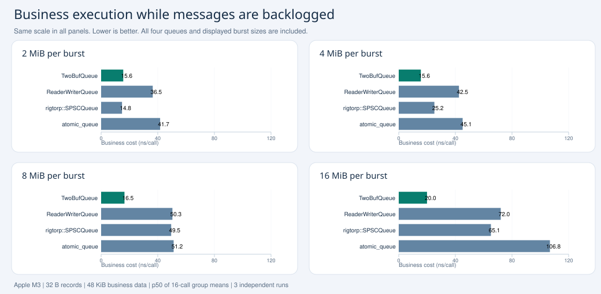
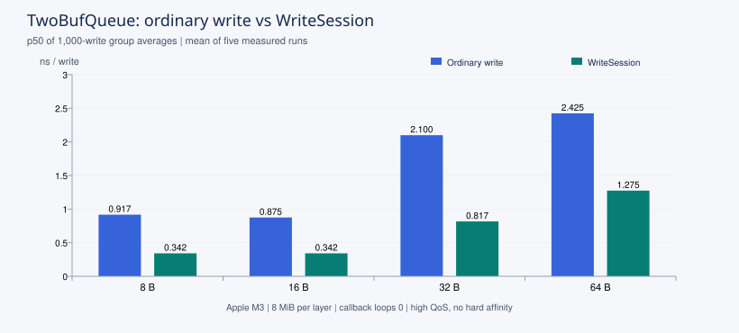

# TwoBufQueue

**Small producer buffers and low write overhead for C++20 logging, telemetry and event collection.**

Each producer writes to its own buffer. A background worker copies batches into an output pool, and an independent callback thread processes records. Keep file I/O and expensive processing off the application thread; use `WriteSession` for tight loops that submit many records.

The two pools have separate size limits: keep the producer's buffer small while the consumer has room for pending work. The measured backlog scenario below uses a **16 KiB producer pool and a 256 MiB output pool**.

[简体中文](README.zh-CN.md) · [Integration](docs/INTEGRATION.md) · [Async logging example](docs/ASYNC_LOGGING.md) · [Benchmarks](docs/PERFORMANCE.md) · [Examples](examples/README.md)

## How it works


Multiple producers use separate Writers and source pools. Records preserve each producer's order. Output callbacks receive borrowed data valid for the duration of the call. An optional direct read path skips layer-2 copying; a typed `SyncContext` runs the callback on the writer's thread. See [API contracts](docs/API.md).

## Minimal example

```cpp
#include <TwoBufQueue.hpp>
#include <cstdio>
#include <string_view>

int main() {
    auto writer = TwoBufQueue::make_writer<TwoBufQueue::Writer<>>();
    auto on_record = [](std::int32_t, const std::byte* data,
                        std::size_t size) noexcept {
        std::printf("%.*s\n", static_cast<int>(size),
                    reinterpret_cast<const char*>(data));
    };
    TwoBufQueue::TwoBufQueue queue(on_record, writer);
    bool ok = true;
    for (std::string_view text : {"hello", "telemetry", "goodbye"})
        ok &= writer.write_mem(text.data(), static_cast<std::uint16_t>(text.size()));
    writer.flush();   // Publish and notify; does not wait for delivery.
    writer.finish();  // Stop production and hand off the tail block.
    queue.stop();     // Drain copying and callbacks before leaving this scope.
    return ok && queue.error_code() == TwoBufQueue::ReadError::none ? 0 : 1;
}
```

The [async logger](examples/two_buf_queue/09_async_logger.cpp) adds bounded buffers, pressure statistics, a slow-sink option and verification of the saved file. It distinguishes queue `flush()` from flushing the file.

## Business execution under message backlog



The producer sends a batch, then immediately queries and updates the same 48 KiB business data set. A slow callback maintains approximately 198–205 MiB of pending messages. TwoBufQueue uses a 16 KiB source pool; each native SPSC queue has 256 MiB of slot storage. All use the same 32-byte messages and callback work. The figure includes every displayed burst size and queue; smaller is better.

Apple M3 / macOS 14.4.1 / Clang 18.1.8, three independent runs, high producer QoS without hard affinity. Values are p50 of 16-call business group averages, averaged across runs, rather than individual-call latency. The 16 MiB case records approximately **20 ns/call** for TwoBufQueue, **72 ns** for ReaderWriterQueue, **65 ns** for rigtorp and **107 ns** for atomic_queue. At 2 MiB, rigtorp is slightly faster than TwoBufQueue. [Full scenario, parameters, verification and raw samples](docs/performance_burst_cache.html).

## Current producer-write comparisons

All three reports use 256 MiB native/output storage, callback loop count 0 and three independent runs. Each report selects one common TwoBufQueue block configuration across all four payload sizes, using the disclosed combined score over throughput and p50/p99/p999. Producer source-pool limits are separate and listed in the report. The scores compare measured configurations on this host; they do not establish a universal ranking.

| Submission mode | Report |
|---|---|
| Single-block WriteSession | [Session](docs/performance_256m_zero_session_plateau.html) |
| Ordinary write, publish at block handoff | [Maximum publish count](docs/performance_256m_zero_publish_max_plateau.html) |
| Ordinary write, publish every record | [Publish every record](docs/performance_256m_zero_publish1_plateau.html) |

Latency in these reports is the quantile of **1,000-write group averages**, rather than individual-call or time-to-callback latency. Source code, parameters, all trials and reproduction commands are provided in [performance evidence](docs/PERFORMANCE.md).

## Earlier matched producer-write experiment



This chart compares the **same TwoBufQueue parameters**, ordinary `write` and single-block Session. Apple M3 / macOS 14.4.1 / Clang 18.1.8; 10 million messages per run, five runs; callback loop count 0; each layer's payload pool 8 MiB (16 MiB total). High QoS, **no hard CPU affinity**. p50 is the quantile of **1,000-write group averages**, not individual-call or end-to-end latency. Send timing excludes round draining, but includes block acquisition and switching. [Chart source and full measurement conditions](docs/PERFORMANCE.md).

| Condition | Ordinary write | WriteSession |
|---|---|---|
| 8 MiB per layer, callback loop count 0 | [Report](docs/performance_8m_zero.html) | [Report](docs/performance_8m_zero_session.html) |
| 256 MiB per layer, calibrated callback work | [Report](docs/performance_256m_callback.html) | [Report](docs/performance_256m_callback_session.html) |

Reports also include ReaderWriterQueue, rigtorp/SPSCQueue and atomic_queue. All measured trials, parameters and commands are retained. An independent copy-constructor A/B shows large changes in some native queues even with identical payloads and valid data; these differences cannot all be attributed to queue algorithms. See [benchmark methodology](docs/PERFORMANCE.md) before interpreting the comparison.

## Build and integrate

Requires CMake 3.20+, a C++20 compiler and thread support. Default detailed tests require Python 3.9+. No third-party runtime dependency. The macOS implementation requires **macOS 14.4+ and a supporting SDK**.

```sh
cmake -S . -B build -DCMAKE_BUILD_TYPE=Release
cmake --build build --config Release --parallel
ctest --test-dir build -C Release --output-on-failure
```

For a vendored checkout:

```cmake
add_subdirectory(external/TwoBufQueue)
target_link_libraries(your_app PRIVATE TwoBufQueue::TwoBufQueue)
```

Tests and examples default to OFF when embedded in another project. For an installed package:

```cmake
find_package(TwoBufQueue 0.1 CONFIG REQUIRED)
target_link_libraries(your_app PRIVATE TwoBufQueue::TwoBufQueue)
```

[Integration instructions](docs/INTEGRATION.md) cover installation, relocatable packages and `FetchContent`. The CMake package version is 0.1.0; no release tag is implied by that metadata.

## Choose a starting point

| Need | Example |
|---|---|
| Submit individual records | [01_basic](examples/01_basic.cpp) |
| Process complete batches | [02_batch_callback](examples/two_buf_queue/02_batch_callback.cpp) |
| Multiple producer threads | [03_multi_thread_writer](examples/two_buf_queue/03_multi_thread_writer.cpp) |
| Read source blocks directly | [04_layer1_callback](examples/two_buf_queue/04_layer1_callback.cpp) |
| Attach sequence numbers | [05_seq_writer](examples/two_buf_queue/05_seq_writer.cpp) |
| Execute callbacks on the producer | [06_sync_writer](examples/two_buf_queue/06_sync_writer.cpp) |
| Write many records in a loop | [07_quick_write_muti_msg](examples/two_buf_queue/07_quick_write_muti_msg.cpp) |
| Tune construction parameters | [08_all_parameters](examples/two_buf_queue/08_all_parameters.cpp) |
| Write application logs asynchronously | [09_async_logger](examples/two_buf_queue/09_async_logger.cpp) |

## Usage boundaries

- One producer thread per Writer. Register every Writer before starting the readers; each source queue has one reader owner. There is no global FIFO across producers.
- Check write results. Bounded pools can fill: the default Drop policy rejects a record immediately; Block waits up to its configured timeout and can also fail.
- Default records carry a two-byte length prefix, with at most 65,535 payload bytes. Each complete record must fit its source block. Object bytes are an in-process representation, not a serialization format.
- Do not retain callback pointers. Copy data into application-owned storage before dispatching work elsewhere. `noexcept` callbacks must record or handle their own errors.
- With current-block scanning disabled, `flush()` cannot deliver a partial current block. Use an explicit handoff or `finish()` for the tail. With scanning enabled, publishing and scheduling still affect delivery latency.
- Stop and join producers, call each Writer's `finish()`, then `queue.stop()` and check its error. Queue flush does not wait for delivery or imply durable storage.

This component suits batched processing and low producer submission overhead. Sparse inputs and strict individual-record latency need separate end-to-end measurement and appropriate publication/read settings. See [API details](docs/API.md), [test evidence](test/READ_CTRL_TESTS.md), and [contributing](CONTRIBUTING.md). Linux/Windows/macOS CI is configured; the saved local results identify which platforms actually ran.

Licensed under [Apache-2.0](LICENSE), copyright © 2026 chuan lu. See [NOTICE](NOTICE).
