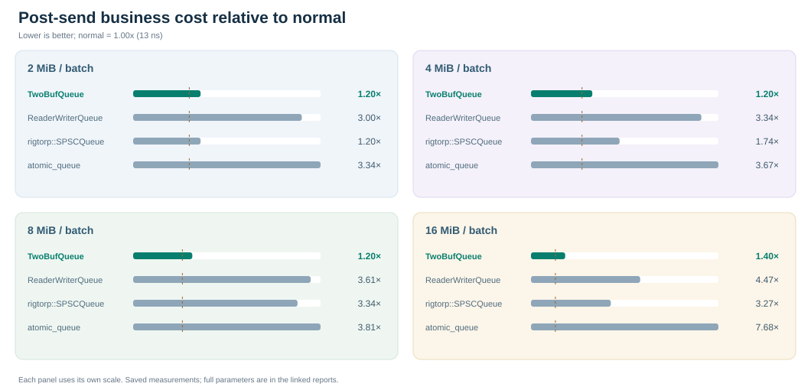

# TwoBufQueue

**TwoBufQueue 是一个 C++ 生产者—消费者消息队列组件，用于在线程之间高速传递数据。**

为追求生产者热路径性能，采用双层缓存设计，通过批量发布和传输，让生产者使用小缓存，让消费者使用大缓存处理消息，尽可能降低消息传输对业务执行的影响。支持单个或多个生产者、消费者；当前要求 C++20。

[English](README.md) · [完整介绍](README_DETAIL.zh-CN.md) · [接口指南](docs/guides/API.zh-CN.md) · [使用示例](examples/README.zh-CN.md) · [性能测试](docs/reports/PERFORMANCE.zh-CN.md)

**目录**

- [一、几个问题](#一几个问题)
  - [1.1 没有背压，为什么发送完消息后业务还是慢了好几倍？](#11-没有背压为什么发送完消息后业务还是慢了好几倍)
  - [1.2 消息只有几个字节，批量提交究竟能快多少？](#12-消息只有几个字节批量提交究竟能快多少)
  - [1.3 消息缓存满了，生产者必须等吗？](#13-消息缓存满了生产者必须等吗)
  - [1.4 对于大消息，怎么发送才能达到更好的效果？](#14-对于大消息怎么发送才能达到更好的效果)
  - [1.5 消息缓存太小会背压，太大又浪费，怎么办？](#15-消息缓存太小会背压太大又浪费怎么办)
- [二、有多快？](#二有多快)
  - [2.1 消息提交速度](#21-消息提交速度)
  - [2.2 连续发送一批消息后，业务还能跑多快？](#22-连续发送一批消息后业务还能跑多快)
- [三、什么时候更合适？](#三什么时候更合适)
  - [3.1 适合的场景](#31-适合的场景)
  - [3.2 需要考虑的取舍](#32-需要考虑的取舍)
- [四、如何开始？](#四如何开始)
  - [4.1 最小使用示例](#41-最小使用示例)
  - [4.2 构建与接入](#42-构建与接入)
- [五、完整文档](#五完整文档)

---

## 一、几个问题

### 1.1 没有背压，为什么发送完消息后业务还是慢了好几倍？

队列还有空位，发送也没有阻塞，看起来一切正常。但是，连续发送一批消息后，再执行同样一段业务代码，耗时却可能增加好几倍。既然没有等待，多出来的时间究竟花在哪里？

### 1.2 消息只有几个字节，批量提交究竟能快多少？

一条消息只有 8 或 16 字节，复制这些数据应该很快。但消息越小，发送过程中其他工作的开销就越值得关注。同样的数据量和发送次数，逐条提交与批量提交，性能究竟能相差多少？

### 1.3 消息缓存满了，生产者必须等吗？

消费者处理速度出现波动，消息不断积压，最终用满了缓存。等待会打断业务线程的节奏，丢弃又可能损失重要消息。除了等待和丢弃，能否给消息安排另一条去路，同时让内存占用保持可控？

### 1.4 对于大消息，怎么发送才能达到更好的效果？

平时发送的可能只是几十字节的记录，偶尔却要传输几 MiB 的快照、采样结果或数据块。一次发送就要写入大片内存，怎样才能既快速传输，又尽量减少对随后业务执行的影响？

### 1.5 消息缓存太小会背压，太大又浪费，怎么办？

缓存设小了，担心突发消息装不下，让生产者等待；设大了，又可能为偶尔出现的峰值长期保留大量内存。日常消息量与峰值相差很大时，怎样才能兼顾突发容量和内存占用？

> TwoBufQueue 正是围绕这些问题设计和持续优化的。具体解决思路与后续计划，请参考[问题与解决](README_DETAIL.zh-CN.md#二问题与解决)。想了解具体性能，请继续往下看。

## 二、有多快？

### 2.1 消息提交速度

下图比较生产者提交消息的吞吐，单位 **M条/s，越高越好**。TwoBufQueue 使用 `WriteSession`，消费者同时运行。


[Session 完整结果](docs/reports/comparison/performance_256m_zero_session_plateau.zh-CN.md) · [普通 write，批量发布](docs/reports/comparison/performance_256m_zero_publish_max_plateau.zh-CN.md) · [普通 write，每条发布](docs/reports/comparison/performance_256m_zero_publish1_plateau.zh-CN.md)

### 2.2 连续发送一批消息后，业务还能跑多快？

所有队列执行同一流程：**正常执行业务 → 连续发送一批消息 → 立刻执行同样的业务**。图中为发送后耗时 / 正常耗时，越低越好。



本机正常业务约 **13 ns/次**。发送 16 MiB 后，TwoBufQueue 为 **18.2 ns/次**，ReaderWriterQueue 为 58.2，rigtorp 为 42.5，atomic_queue 为 99.8。[完整实验与参数](docs/reports/burst/performance_burst_from_empty.zh-CN.md)

两组实验在 Apple M3 上分别测量，不能混为同一个配置：发送吞吐实验中，两层池各为 256 MiB，回调循环为 0；业务实验中，生产者池为 16 KiB、消费者池为 256 MiB，回调循环为 64。开源队列均使用 256 MiB 消息存储。三轮平均，高 QoS，未硬绑核；测量范围与限制见完整报告。

## 三、什么时候更合适？

### 3.1 适合的场景

当你对第一章的这些问题感兴趣或者也遇到相关问题时，就可以考虑使用 TwoBufQueue。

简单地说：生产者线程是热路径线程，消费者线程是辅助线程；希望热路径线程尽量保持稳定高效，同时希望生产者线程能够高速发送消息。例如机器人、传感器、量化交易等低延时应用。

**同时，我会持续完善这个组件。如果您有相关的需求或想法，欢迎随时提出；只要是公共、通用的需求，我都会尽力去实现好。**

### 3.2 需要考虑的取舍

两层传输增加复制和后台工作。若最重要的是每条消息从发送到接收的时间，或消息很少、处理很轻，单层队列可能更合适。容量有限，复制进度不足或持续过载仍会造成背压。

[完整的优势、取舍与设计对比](README_DETAIL.zh-CN.md)

## 四、如何开始？

### 4.1 最小使用示例

通过 Writer 发送数据，在 `on_record` 回调中接收消息。

```cpp
#include <TwoBufQueue.hpp>
#include <cstdio>
#include <string_view>

int main() {
    //---------------1.初始化-----------------------------------------------
    auto writer = TwoBufQueue::make_writer<TwoBufQueue::Writer<>>();
    // 接收消息的回调函数。
    auto on_record = [](std::int32_t, const std::byte* data,
                        std::size_t size) noexcept {
        std::printf("%.*s\n", static_cast<int>(size),
                    reinterpret_cast<const char*>(data));
    };
    TwoBufQueue::TwoBufQueue queue(on_record, writer);

    //---------------2.生产者写数据------------------------------------------
    bool ok = true;
    for (std::string_view text : {"hello", "telemetry", "goodbye"})
        ok &= writer.write_mem(text.data(), static_cast<std::uint16_t>(text.size()));
    writer.flush();   // 发布并通知；不等待回调完成。

    //---------------3.结束-------------------------------------------------
    writer.finish();  // 停止生产，交接尾块。
    queue.stop();     // 等待复制和回调排空，再结束作用域。

    //---------------4.校验测试结果------------------------------------------
    return ok && queue.error_code() == TwoBufQueue::ReadError::none ? 0 : 1;
}
```

### 4.2 构建与接入

需要 **CMake 3.20+、C++20 编译器和线程支持**，库运行不依赖第三方组件。macOS 需要 14.4+ 及对应 SDK；运行详细测试另需 Python 3.9+。

```sh
cmake -S . -B build -DCMAKE_BUILD_TYPE=Release
cmake --build build --config Release --parallel
ctest --test-dir build -C Release --output-on-failure
```

通过 CMake 链接 `TwoBufQueue::TwoBufQueue`。[安装和项目接入](docs/guides/INTEGRATION.zh-CN.md) · [更多使用示例](examples/README.zh-CN.md)

## 五、完整文档

| 想了解什么 | 从这里开始 |
|---|---|
| 为什么采用双层缓存、适用场景与后续计划 | [完整介绍 README_DETAIL](README_DETAIL.zh-CN.md) |
| 写入、发布、回调、线程与参数 | [接口指南](docs/guides/API.zh-CN.md) |
| Session、多个生产者、同步回调等具体用法 | [使用示例](examples/README.zh-CN.md) |
| 测量口径、参数与复现方法 | [性能测试说明](docs/reports/PERFORMANCE.zh-CN.md) |
| 使用队列实现异步日志 | [异步日志指南](docs/guides/ASYNC_LOGGING.zh-CN.md) |

Apache-2.0。[许可证](LICENSE) · [参与贡献](CONTRIBUTING.zh-CN.md)
