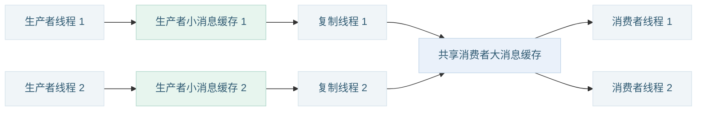

# TwoBufQueue

**TwoBufQueue 是一个 C++ 生产者—消费者高性能消息队列组件，用于在线程之间高速传递数据。**

为追求生产者热路径性能，采用双层缓存设计，通过批量发布和传输，让生产者使用小缓存，让消费者使用大缓存容纳积压，尽可能降低消息传输对业务执行的影响。

[简短首页](https://xiyang1314.github.io/TwoBufQueue/README.zh-CN.html) · [文档导航](https://xiyang1314.github.io/TwoBufQueue/docs/index.zh-CN.html) · [English](https://xiyang1314.github.io/TwoBufQueue/README_DETAIL.html) · [接口指南](https://xiyang1314.github.io/TwoBufQueue/docs/guides/API.zh-CN.html) · [性能测试](https://xiyang1314.github.io/TwoBufQueue/docs/reports/PERFORMANCE.zh-CN.html) · [示例索引](https://xiyang1314.github.io/TwoBufQueue/examples/README.zh-CN.html) · [代码阅读](https://xiyang1314.github.io/TwoBufQueue/docs/code/index.zh-CN.html)

**目录**

- [一、有多快？](#一有多快)
  - [1.1 消息能提交多快？](#11-消息能提交多快)
  - [1.2 连续发送一批消息，业务还能跑多快？](#12-连续发送一批消息业务还能跑多快)
  - [1.3 历史同参数写入实验](#13-历史同参数写入实验)
- [二、问题与解决](#二问题与解决)
  - [2.1 没有背压，为什么业务线程偶尔还变慢好几倍呢？](#21-没有背压为什么业务线程偶尔还变慢好几倍呢)
  - [2.2 批量发布与交接相比每条交接，性能提高得多吗？](#22-批量发布与交接相比每条交接性能提高得多吗)
  - [2.3 消息缓存满了，生产者必须一直等吗？](#23-消息缓存满了生产者必须一直等吗)
  - [2.4 消息缓存太小会背压，太大又浪费，怎么办？](#24-消息缓存太小会背压太大又浪费怎么办)
  - [2.5 对于大消息，怎么发送才能达到更好的效果？](#25-对于大消息怎么发送才能达到更好的效果)
  - [2.6 优先使用刚归还的空闲缓存有意义吗？](#26-优先使用刚归还的空闲缓存有意义吗)
- [三、与常规单层缓存队列对比](#三与常规单层缓存队列对比)
  - [3.1 SPSC：单生产者、单消费者](#31-spsc单生产者单消费者)
  - [3.2 MPMC：多生产者、多消费者](#32-mpmc多生产者多消费者)
  - [3.3 设计要点](#33-设计要点)
- [四、使用场景](#四使用场景)
  - [4.1 优势场景](#41-优势场景)
  - [4.2 劣势场景](#42-劣势场景)
- [五、如何使用](#五如何使用)
  - [5.1 最小使用示例](#51-最小使用示例)
  - [5.2 按用途选择示例](#52-按用途选择示例)
  - [5.3 构建与接入](#53-构建与接入)
  - [5.4 使用边界](#54-使用边界)
- [六、后续计划](#六后续计划)

---

## 一、有多快？

有人说，作为男人不能太快。但是作为一个程序员，写的程序必须是越快越好。

### 1.1 消息能提交多快？

为了追求极致的性能，TwoBufQueue 提供单块 `WriteSession`，让生产者在当前块中快速连续写入。

下面四张图展示 **Session 对照实验的生产者发送吞吐，单位 M条/s，越高越好**。四种消息长度使用同一组 TwoBufQueue 参数，开源队列使用各自的测量配置；其他实现保持上游源码不变。


这些数字只计生产者发送阶段，包括申请块、换块和发送期间的等待；每轮发送后的排空在计时外。测试启用真实的复制线程和消费线程。回调循环为 0 次，开源槽位／TwoBufQueue 第二层容量均为 256 MiB；此 Session 配置的第一层也为 256 MiB，和下方 16 KiB 生产者池的业务测试是两个不同实验。

| 你的发送方式 | 查看完整结果 |
|---|---|
| 在一个块中连续写多条消息 | [WriteSession](https://xiyang1314.github.io/TwoBufQueue/docs/reports/comparison/performance_256m_zero_session_plateau.zh-CN.html) |
| 使用普通 write，允许在块交接时发布 | [批量发布](https://xiyang1314.github.io/TwoBufQueue/docs/reports/comparison/performance_256m_zero_publish_max_plateau.zh-CN.html) |
| 使用普通 write，每条消息都发布进度 | [每条发布](https://xiyang1314.github.io/TwoBufQueue/docs/reports/comparison/performance_256m_zero_publish1_plateau.zh-CN.html) |

报告还包含 p50、p99、p999 和背压。写入耗时按每组 **1,000 次写入的平均耗时**统计，不是单次调用或端到端延时；不同写入方式分别调优。完整负载、参数、三轮数据和复现命令见[性能测试说明](https://xiyang1314.github.io/TwoBufQueue/docs/reports/PERFORMANCE.zh-CN.html)。

### 1.2 连续发送一批消息，业务还能跑多快？

发送快很重要，发送完后业务还能保持多快，同样重要。机器人控制、高频交易等低延迟系统对热路径要求特别高。发送完一批消息以后，执行同样一段代码，性能能相差多少呢？

经过测试发现，性能甚至会相差好几倍。这里让所有队列执行相同的流程：**正常执行业务函数 → 连续发送一批消息 → 立刻执行同样的业务函数**，观察消息发送对后续业务的影响。

下图的数值表示：**发送完消息后执行业务函数的时间 ÷ 正常执行业务函数的时间**。本节只展示测试结果，下一章会解释原因。


**正常业务约 13 ns/次。发送 16 MiB 后，TwoBufQueue 为 18.2 ns/次，ReaderWriterQueue 为 58.2 ns/次，rigtorp 为 42.5 ns/次，atomic_queue 为 99.8 ns/次。** TwoBufQueue 的生产者消息池只有 16 KiB，消费端消息池为 256 MiB；另外三个队列的槽位存储均为 256 MiB。

### 1.3 历史同参数写入实验

图中普通 write 与单块 Session 使用相同参数。环境为 Apple M3、macOS 14.4.1、Clang 18.1.8；每次 1,000 万条、5 次取平均，回调循环次数为 0；两层数据池各 8 MiB，合计 16 MiB。本机高 QoS，**未硬绑核**。

p50 是每组 **1,000 次写入平均耗时**的分位数，不能当成单次调用或端到端延时。吞吐累计分轮发送时间，排空在计时外，申请块和换块在写入计时内。[数据来源与完整测量口径](https://xiyang1314.github.io/TwoBufQueue/docs/reports/PERFORMANCE.zh-CN.html)。

| 条件 | 普通 write | WriteSession |
|---|---|---|
| 每层 8 MiB，回调循环 0 次 | [报告](https://xiyang1314.github.io/TwoBufQueue/docs/reports/comparison/performance_8m_zero.html) | [报告](https://xiyang1314.github.io/TwoBufQueue/docs/reports/comparison/performance_8m_zero_session.html) |
| 每层 256 MiB，回调工作量校准 | [报告](https://xiyang1314.github.io/TwoBufQueue/docs/reports/comparison/performance_256m_callback.html) | [报告](https://xiyang1314.github.io/TwoBufQueue/docs/reports/comparison/performance_256m_callback_session.html) |

报告还对比 ReaderWriterQueue、rigtorp/SPSCQueue 与 atomic_queue，保留全部正式次数、参数和命令。独立 A/B 实验表明，外部负载复制构造的变化会显著改变部分队列的成绩，不能把差异全部归因于队列算法。完整数据校验通过，也不意味着这些数字是所有平台的通用排名。

## 二、问题与解决

队列发送本身的开销，只是热路径性能的一部分。下面从业务中容易遇到的六个问题出发，说明 TwoBufQueue 的做法、收益和当前边界。

### 2.1 没有背压，为什么业务线程偶尔还变慢好几倍呢？

很多人会认为，只要队列缓存设置得足够大，没有发生背压，消息发送就不会影响业务线程。

但是，即便没有背压，如果生产者连续发送大量消息后，业务线程性能可能会大幅度降低。原因是大量发送消息会占用很多缓存，从而冲刷掉当前业务线程 CPU 的热缓存。

TwoBufQueue 让生产者反复使用较小的消息池，把较大的积压空间留给消费端，尽可能减轻消息发送对后续业务的影响。上方实验关注的正是这种情况：[发送后业务性能](https://xiyang1314.github.io/TwoBufQueue/docs/reports/burst/performance_burst_from_empty.zh-CN.html)。

### 2.2 批量发布与交接相比每条交接，性能提高得多吗？

批量发布相比每条发布，性能究竟会相差多少呢？性能测试结果显示，热路径上的差距可以达到好几倍。

例如，本机 8 B 消息实测中，**Session 连续写入吞吐约 2,306.5 M条/s，普通 write 批量发布约 1,022 M条/s，每条发布约 490 M条/s。** 相比每条发布，Session 约为 **4.7 倍**，普通批量发布约为 **2.1 倍**。

具体见 [Session 报告](https://xiyang1314.github.io/TwoBufQueue/docs/reports/comparison/performance_256m_zero_session_plateau.zh-CN.html)、[普通批量发布报告](https://xiyang1314.github.io/TwoBufQueue/docs/reports/comparison/performance_256m_zero_publish_max_plateau.zh-CN.html)、[每条发布报告](https://xiyang1314.github.io/TwoBufQueue/docs/reports/comparison/performance_256m_zero_publish1_plateau.zh-CN.html)。各方式采用各自调优后的参数，数字对应完整实测配置。

### 2.3 消息缓存满了，生产者必须一直等吗？

消费者暂时变慢时，只要缓存还有空间，常规单层队列也能继续接收消息。真正需要处理的是缓存达到容量上限之后：生产者可能等待，或按策略放弃本次写入。

TwoBufQueue 当前通过两层独立配置的缓存和后台复制承接短时积压，尽早归还生产者的块。容量有限，消费端缓存用满或复制跟不上时，仍可能产生背压。

**计划中的解决方式：第二层缓存序列化到文件与回读。** 当第二层内存缓存接近上限时，将部分积压消息保存到文件，随后读取并继续交给消费者处理，以文件暂存扩展可容纳的积压量。

双层结构让这项扩展可以集中在第二层：后台负责文件存储与回读，生产者仍使用第一层写入和交接路径。可承接的积压量仍受磁盘容量和落盘速度限制。**该功能尚未实现。** [查看后续计划](#六后续计划)。

### 2.4 消息缓存太小会背压，太大又浪费，怎么办？

容量小了，担心突发消息装不下；容量大了，又可能为偶尔出现的峰值长期保留大量内存。日常流量和峰值流量差距越大，这个选择越难。

TwoBufQueue 可以设置一个较宽松的内存上限，内存池根据实际需要申请内存块。配置空闲块保留上限后，多余的空闲块也会进入回收流程，根据预设参数动态调整。

当前快捷构造默认保留空闲块；需要自动回收时，可在手动构造源池时设置空闲块保留上限。配置方法见[内存池动态调整](https://xiyang1314.github.io/TwoBufQueue/docs/guides/API.zh-CN.html#按需分配与空闲块回收)。

### 2.5 对于大消息，怎么发送才能达到更好的效果？

多数消息很小，偶尔却要发送一份很大的快照、采样结果或数据块。即使这次只发送一条消息，连续写入大片消息内存，也可能影响 CPU 缓存中保留的业务数据，让随后的业务变慢。

这里的关键是一次发送触及了多少内存。它和连续发送很多小消息造成的缓存干扰属于同一类问题，但大消息还涉及如何保持较小的生产者写入区域。

**计划中的解决方式：大消息拆分与重组。** 将大消息分成多个小块，依次交给复制线程，在消费端重新拼装。**预期收益：** 即便消息很大，也让生产者集中复用较小的消息内存区域，尽可能减小对业务线程热缓存的干扰，帮助业务线程保持稳定运行。

**该功能尚未实现。** 当前单条完整记录必须装入一个源块；前面的 32 B 消息批量测试没有测试大消息拆分，专项结果将在实现后补充。[查看后续计划](#六后续计划)。

### 2.6 优先使用刚归还的空闲缓存有意义吗？

有意义，而且对于批量发送十分关键。计划中的大消息拆分，也会沿用这种复用策略。

例如，生产者缓存上限设置为 **10 MiB**，池里已经分配了很多内存块。如果依次循环使用所有空闲块，批量发送时写入的范围就可能逐步铺满这 10 MiB 内存，对业务线程 CPU 热缓存的影响会比较大。

如果优先使用刚归还的空闲块，在后台能够及时归还的情况下，生产者就可以集中复用较少的块，减少反复写入的内存范围，对业务热缓存的干扰也更小。TwoBufQueue 采用的就是这种策略。

[缓存池设计与实现](https://xiyang1314.github.io/TwoBufQueue/docs/code/src/base_components/warm_pool/warm_pool.hpp.zh-CN.html)。

## 三、与常规单层缓存队列对比

双层缓存要解决的是一个常见矛盾：消费端希望有足够空间容纳积压，生产者又希望反复使用的消息内存尽量小。

### 3.1 SPSC：单生产者、单消费者

常见单层队列让生产者和消费者共用消息存储，积压的消息保留在这层缓存中。


TwoBufQueue 把生产者反复使用的小源池和容纳积压的大消费池分开配置；复制线程批量交接数据，让源块可以尽早复用。


### 3.2 MPMC：多生产者、多消费者

每个生产者各有一个 Writer 和源池。默认一个消费者线程；SPMC／MPMC 输出模式可使用多个消费者线程。也可以在回调中将数据复制到应用自有存储，再交给业务线程池处理。

下面以 2 个生产者、2 个复制线程和 2 个消费者为例。每个生产者独立使用自己的 Writer 和小消息缓存，复制线程将数据交接到共享的消费者大消息缓存，多个消费者从中领取不同批次并行处理。



消费者分担任务，不是每个消费者都接收所有消息。线程数量可以配置。[线程与输出模式配置](https://xiyang1314.github.io/TwoBufQueue/docs/guides/API.zh-CN.html#多生产者与多消费者)。

### 3.3 设计要点

TwoBufQueue 的两张图展示的是双层异步路径；可选直接读取路径省去第二层复制，非 void `SyncContext` 则让逐条回调在生产者线程执行。配置和数据生命周期见[接口文档](https://xiyang1314.github.io/TwoBufQueue/docs/guides/API.zh-CN.html)。

这些设计与前面问题的对应关系如下：

| 用户关心的问题 | 对应做法 | 目标收益 |
|---|---|---|
| 没有背压，业务仍然变慢 | 小生产者池、大消费端池 | 减轻消息写入对业务缓存的干扰 |
| 每条消息都要协调进度 | 批量发布与交接 | 降低平均提交开销 |
| 消费者短暂变慢 | 独立复制线程搬运到消费端 | 尽早复用生产者源块 |
| 日常流量与峰值相差很大 | 按需分配，按配置回收多余空闲块 | 动态管理内存占用与突发容量 |
| 偶尔发送特别大的消息 | 大消息拆分与重组（计划中） | 以小生产者池传输大消息 |
| 空闲块如何再次使用 | 最近归还的块优先复用 | 增加近期内存被反复使用的机会 |

## 四、使用场景

### 4.1 优势场景

#### 4.1.1 批量发送消息

**场景：** 一次计算结束后，要连续发送一批结果、日志、采样数据或事件。消息已经准备好，希望尽快提交，再继续下一项业务。

**优势：** 连续发送时可以获得很低的生产者提交开销。相比每条都走完整提交流程，TwoBufQueue 的批量写入方式能减少重复工作，让业务线程更快完成这一批发送。

[性能对比](https://xiyang1314.github.io/TwoBufQueue/docs/reports/comparison/performance_256m_zero_session_plateau.zh-CN.html) · [使用示例](https://xiyang1314.github.io/TwoBufQueue/docs/code/examples/two_buf_queue/07_quick_write_muti_msg.cpp.zh-CN.html)

#### 4.1.2 允许批量通知与处理

**场景：** 日志收集、遥测上报和事件汇总通常可以积攒一小批再处理，不要求每条消息刚写入就立刻接收。

**优势：** 相比逐条共享进度和交接，集中提交一批消息可以减少生产者与辅助线程之间的协调工作。在能接受批量到达的业务中，把更多 CPU 时间留给生产者业务，同时保持高吞吐。

[批量发布的性能结果](https://xiyang1314.github.io/TwoBufQueue/docs/reports/comparison/performance_256m_zero_publish_max_plateau.zh-CN.html) · [每条发布的性能结果](https://xiyang1314.github.io/TwoBufQueue/docs/reports/comparison/performance_256m_zero_publish1_plateau.zh-CN.html)

#### 4.1.3 传输较大的消息或数据块

**场景：** 需要交付一批传感器采样、拼接后的记录或其他连续数据块，希望后台处理，不让生产者承担后续计算或存储工作。

**优势：** 可以把一段连续数据作为消息交给消费端，减少业务层逐条分发，并把耗时处理留在辅助线程。消费端容纳积压的容量可以独立配置。后续计划通过拆分与重组，让超过单个源块的大消息也能使用较小的生产者消息池传输。

[用法与长度限制](https://xiyang1314.github.io/TwoBufQueue/docs/guides/API.zh-CN.html) · [参数示例](https://xiyang1314.github.io/TwoBufQueue/docs/code/examples/two_buf_queue/08_all_parameters.cpp.zh-CN.html)。当前单条消息须装入一个源块；大消息专项性能测试后续补充。

#### 4.1.4 消费者速度不稳定

**场景：** 消费者写文件、批量计算或调用外部服务，处理速度时快时慢；生产者仍希望按自己的节奏继续运行。

**优势：** 可以在消费端保留较大的积压空间，同时保持生产者消息池较小。相比只扩大一个共享队列，TwoBufQueue 更容易兼顾容纳短暂积压与控制生产者的内存使用，减少消费变慢对业务线程的影响。

缓冲容量有限，持续过载或后台搬运跟不上时仍会产生背压。

#### 4.1.5 追求极致的生产者热路径性能

**场景：** 机器人控制、高频交易等业务线程连续发送状态、行情或事件后，要立刻继续核心计算，不能让消息发送明显拖慢后续业务。

**优势：** 相比连续写入一个很大的单层消息区，小生产者消息池可以减轻消息发送对业务缓存的干扰。收益不仅是发送快，还包括发送完后业务函数仍能保持较低耗时。

[业务性能对比](https://xiyang1314.github.io/TwoBufQueue/docs/reports/burst/performance_burst_from_empty.zh-CN.html)：本机发送 16 MiB 后，TwoBufQueue 的业务耗时从正常约 13 ns/次增至 18.2 ns/次；详细条件见报告。

#### 4.1.6 需要多种生产者—消费者组合

**场景：** 多个业务模块同时产生消息，一个或多个后台工作线程负责处理；也可能先用一个生产者，后续再扩展并发。

**优势：** 一个组件覆盖单生产者、多个生产者以及多个消费者的组合，减少为不同并发需求分别拼装组件的工作。各生产者有自己的写入入口，也可以按来源区分消息，方便接入已有业务。

[多生产者示例](https://xiyang1314.github.io/TwoBufQueue/docs/code/examples/two_buf_queue/03_multi_thread_writer.cpp.zh-CN.html) · [消费线程配置](https://xiyang1314.github.io/TwoBufQueue/docs/code/examples/two_buf_queue/08_all_parameters.cpp.zh-CN.html)

### 4.2 劣势场景

#### 4.2.1 每条消息都必须立即到达

**场景：** 生产者发送一条消息后，消费者必须尽快收到。最关心的是单条消息从发送到接收的时间，而不是一批消息的提交速度。

**劣势：** 双层传输多一次复制，批量交接也可能增加等待。对于这种目标，路径更直接的单层 SPSC 队列通常更合适；生产者写入快，不代表单条消息到达也最快。

#### 4.2.2 消息很少，几乎没有积压

**场景：** 偶尔发送少量消息，消费者始终能轻松跟上，业务线程也没有特别严格的性能要求。

**劣势：** 双层缓存带来的收益可能很小，而额外复制、工作线程与配置仍有成本。单层队列或直接调用通常更简单，集成和维护的工作也更少。

## 五、如何使用

### 5.1 最小使用示例

创建 Writer 和队列，把消息交给 Writer，接收端用回调处理数据。默认是异步处理：业务回调在消费线程执行。

```cpp
#include <TwoBufQueue.hpp>
#include <cstdio>
#include <string_view>

int main() {
    //---------------1.初始化-----------------------------------------------
    auto writer = TwoBufQueue::make_writer<TwoBufQueue::Writer<>>();
    // 接收消息的回调函数。
    auto on_record = [](std::int32_t, const std::byte* data,
                        std::size_t size) noexcept {
        std::printf("%.*s\n", static_cast<int>(size),
                    reinterpret_cast<const char*>(data));
    };
    TwoBufQueue::TwoBufQueue queue(on_record, writer);

    //---------------2.生产者写数据------------------------------------------
    bool ok = true;
    for (std::string_view text : {"hello", "telemetry", "goodbye"})
        ok &= writer.write_mem(text.data(), static_cast<std::uint16_t>(text.size()));
    writer.flush();   // 发布并通知；不等待回调完成。

    //---------------3.结束-------------------------------------------------
    writer.finish();  // 停止生产，交接尾块。
    queue.stop();     // 等待复制和回调排空，再结束作用域。

    //---------------4.校验测试结果------------------------------------------
    return ok && queue.error_code() == TwoBufQueue::ReadError::none ? 0 : 1;
}
```

[异步日志示例](https://xiyang1314.github.io/TwoBufQueue/docs/code/examples/two_buf_queue/09_async_logger.cpp.zh-CN.html) 演示后台写文件、小容量池受压、等待／丢弃、flush 和退出，并逐条校验保存的文件。

当前需要 **C++20**。构建与接入方式见[下方说明](#53-构建与接入)；参数、消息格式和生命周期见[接口指南](https://xiyang1314.github.io/TwoBufQueue/docs/guides/API.zh-CN.html)。

### 5.2 按用途选择示例

| 需求 | 示例 |
|---|---|
| 逐条写入与回调 | [01_basic](https://xiyang1314.github.io/TwoBufQueue/docs/code/examples/01_basic.cpp.zh-CN.html) |
| 一次回调接收一组数据 | [02_batch_callback](https://xiyang1314.github.io/TwoBufQueue/docs/code/examples/two_buf_queue/02_batch_callback.cpp.zh-CN.html) |
| 多个业务线程写入 | [03_multi_thread_writer](https://xiyang1314.github.io/TwoBufQueue/docs/code/examples/two_buf_queue/03_multi_thread_writer.cpp.zh-CN.html) |
| 直接读取源块 | [04_layer1_callback](https://xiyang1314.github.io/TwoBufQueue/docs/code/examples/two_buf_queue/04_layer1_callback.cpp.zh-CN.html) |
| 给记录加序号 | [05_seq_writer](https://xiyang1314.github.io/TwoBufQueue/docs/code/examples/two_buf_queue/05_seq_writer.cpp.zh-CN.html) |
| 在写线程执行回调 | [06_sync_writer](https://xiyang1314.github.io/TwoBufQueue/docs/code/examples/two_buf_queue/06_sync_writer.cpp.zh-CN.html) |
| 循环快速写多条记录 | [07_quick_write_muti_msg](https://xiyang1314.github.io/TwoBufQueue/docs/code/examples/two_buf_queue/07_quick_write_muti_msg.cpp.zh-CN.html) |
| 调整构造参数 | [08_all_parameters](https://xiyang1314.github.io/TwoBufQueue/docs/code/examples/two_buf_queue/08_all_parameters.cpp.zh-CN.html) |
| 后台写业务日志 | [09_async_logger](https://xiyang1314.github.io/TwoBufQueue/docs/code/examples/two_buf_queue/09_async_logger.cpp.zh-CN.html) |

项目中还提供了内存池等基础组件的独立使用示例，具体可看[全部示例导航](https://xiyang1314.github.io/TwoBufQueue/examples/README.zh-CN.html)。

### 5.3 构建与接入

需要 CMake 3.20+、C++20 编译器与线程支持，无第三方运行时依赖。默认详细测试需要 Python 3.9+。macOS 实现需要 **14.4+ 系统和支持对应接口的 SDK**。

```sh
cmake -S . -B build -DCMAKE_BUILD_TYPE=Release
cmake --build build --config Release --parallel
ctest --test-dir build -C Release --output-on-failure
```

直接接入本地源码：

```cmake
add_subdirectory(external/TwoBufQueue)
target_link_libraries(your_app PRIVATE TwoBufQueue::TwoBufQueue)
```

作为其他工程的子项目时，测试和示例默认关闭。安装后接入：

```cmake
find_package(TwoBufQueue 0.6 CONFIG REQUIRED)
target_link_libraries(your_app PRIVATE TwoBufQueue::TwoBufQueue)
```

[接入文档](https://xiyang1314.github.io/TwoBufQueue/docs/guides/INTEGRATION.zh-CN.html) 包含安装命令、可迁移安装目录和 FetchContent 用法。CMake 包版本为 0.6.1，仅用于包版本识别，不表示已创建 Release 或标签。

### 5.4 使用边界

- 同一个 Writer 只能由一个生产线程写入；读取线程启动前完成注册，每个源队列只交给一个读取器。跨生产者不保证全局 FIFO。
- 检查每次写入结果。缓存满时，默认 Drop 立即拒绝；Block 最多等待指定时间，也可能失败。内存池大小、队列容量和输出池分别配置。
- 默认记录使用两字节长度前缀，负载最多 65,535 字节，完整记录必须装得进一个源块。对象字节是进程内表示，不是跨机器序列化协议。
- 回调返回后不得保存数据指针。后续任务要先复制到应用自有存储；`noexcept` 回调自行记录或处理错误。
- 关闭 current 扫描后，flush 不会交付当前未完成块；尾部需要显式交接或 finish。启用扫描时，发布策略与线程调度仍会影响交付延时。
- 先停止并 join 生产线程，再逐个 `writer.finish()`，最后 `queue.stop()` 并检查错误。队列 flush 不等于回调完成或文件落盘。

[接口约定](https://xiyang1314.github.io/TwoBufQueue/docs/guides/API.zh-CN.html) · [测试记录](https://xiyang1314.github.io/TwoBufQueue/test/reader/READ_CTRL_TESTS.html) · [贡献说明](https://xiyang1314.github.io/TwoBufQueue/CONTRIBUTING.zh-CN.html)。Linux、Windows、macOS CI 已配置；保存的本机记录明确列出实际验证平台。

## 六、后续计划

- **大消息拆分与拼装**：让超过单个源块的消息拆成多个块传输，并在消费端重组，以小源块支持更大的消息。目标是减轻大消息连续写入对生产者业务缓存的干扰。当前尚未实现，专项性能测试将随功能补充。
- **第二层缓存序列化到文件与回读**：在第二层内存缓存接近上限时，将部分积压消息序列化保存到文件，随后回读并继续交给消费者处理。文件存储与回读集中在后台第二层，目标是扩展积压容量，同时让生产者继续使用较小的内存缓存。当前尚未实现，文件格式、内存与文件切换策略、消息回读及完整性校验将随功能补充。
- **SeqWriter 后端排序与两阶段处理**：第一阶段由多个线程并行执行可并行的消息处理，结果保留原始消息序号；第二阶段汇集乱序完成的结果，按消息序号排序，并串行执行需要保持消息顺序的处理。目标是兼顾并行处理能力与最终执行顺序。当前 SeqWriter 可以携带序号，尚未实现这一后台有序执行流程；结果暂存和缺失序号等处理规则将随功能补充。
- **更多 C++ 标准版本**：当前最低要求仍为 C++20；后续补充兼容实现和相应构建测试。

采用 [Apache-2.0](LICENSE)，版权所有 © 2026 chuan lu。见 [NOTICE](NOTICE)；[中文许可证](https://xiyang1314.github.io/TwoBufQueue/LICENSE.zh-CN.html) 是参考译文。
