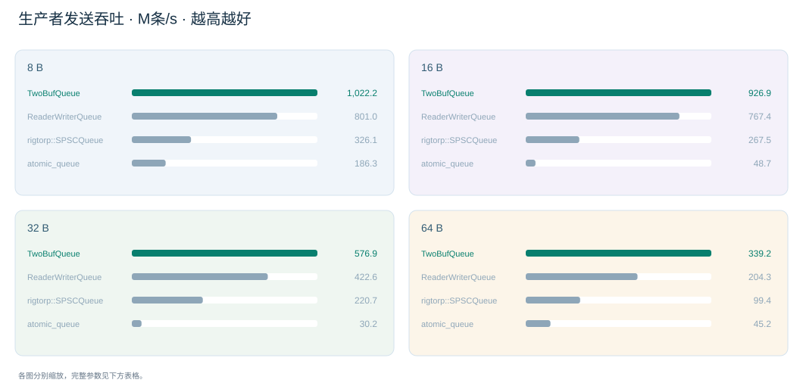

[English](performance_256m_zero_publish_max_plateau.md) · [中文](performance_256m_zero_publish_max_plateau.zh-CN.md)

TWOBUFQUEUE / SPSC BENCHMARK

# 256 MiB 缓存 · 回调循环为 0 · 普通 write · publish MAX

比较生产者线程把消息发送到队列的速度和耗时：吞吐越高越好，生产者发送耗时的 p50 / p99 / p999 越低越好。与 ReaderWriterQueue、rigtorp/SPSCQueue、atomic_queue 对比。

每次 10,000,000 条 3 次平均 8 / 16 / 32 / 64 B 共用参数 权重 35 / 30 / 20 / 15 publish_count = MAX (4,294,967,295) is_scan_current = false 高 QoS · 未硬绑核

[测什么](#本报告测什么) · [概览](#吞吐概览) · [性能对比](#性能对比) · [三次原始结果](#三次原始结果) · [全部参数](#全部初始化参数) · [测试方法](#测试方法与环境)

## 本报告测什么？

测生产者向队列发送消息的吞吐与耗时：消息交给队列有多快，生产者每条消息要花多少时间。

对比 TwoBufQueue、ReaderWriterQueue、rigtorp/SPSCQueue 和 atomic_queue，消息长度为 8 / 16 / 32 / 64 B。**TwoBufQueue 使用普通 write，只在块交接时发布进度，不扫描当前未完成块。** 业务回调循环次数为 0，消费者仍正常接收消息并调用回调。

**测试流程：** 提前准备消息 → 生产者连续发送并计时 → 停止计时 → 等待本轮消息消费完成。所有队列采用相同的消息条数和长度。

**计时范围：** 计入生产者发送阶段的消息复制、进度发布、发送中发生的申请块或换块，以及可能的重试等待。输入准备、轮末交接与回调排空在计时外执行；复制和消费线程同时运行，仍会影响生产者的实际速度。

**吞吐：** 成功发送的消息总数 ÷ 生产者累计发送时间，单位 M条/s（每秒百万条消息），越高越好。数据吞吐 GB/s 按消息净负载字节数计算。

**p50、p99、p999 都是生产者线程发送消息耗时的分位数，越低越好。** 为精确测量很短的发送操作，每连续发送 1,000 条成功消息计时一次，再将这组时间除以 1,000，得到一个“平均每条发送耗时”样本。

**p50（50% 分位）：** 在一次运行中，50% 的分组样本，其平均每条发送耗时不超过这个值。

**p99（99% 分位）：** 在一次运行中，99% 的分组样本，其平均每条发送耗时不超过这个值。

**p999（99.9% 分位）：** 在一次运行中，99.9% 的分组样本，其平均每条发送耗时不超过这个值。

每次运行分别计算这些分位数，表中再取三次运行结果的平均值。这里衡量的是 **生产者提交消息的开销**：分位数来自每组 1,000 条的平均耗时，不是单次 write 调用的分位数，也不是从发送到消费者收到消息的端到端延时。

其他模式：[WriteSession](performance_256m_zero_session_plateau.zh-CN.md) · [普通 write · 每条 publish](performance_256m_zero_publish1_plateau.zh-CN.md)

## 吞吐概览

同一长度的四个队列放在一起；吞吐单位 M条/s。

完整数据与顺序校验通过 按四项指标选定共同参数 各队列每份报告只用一套调优参数

TwoBufQueue 两层数据池各固定 **256 MiB**，合计 512 MiB；原生 SPSC 的消息存储预算为 256 MiB。备用槽、padding 计入预算，控制结构另计。

**每个队列的吞吐、p50、p99、p999 使用同一套参数，8 / 16 / 32 / 64 B 也共用这套调优参数。** 按权重 35% / 30% / 20% / 15% 综合选参，四种长度等权参与。原生容量随消息长度按固定字节预算推导，复制策略沿用各长度已固定的负载实现。

此次用共同参数对应的遍历阶段三次实测值更新表格，因此数值与旧版逐项独立选优不同；原始记录保留，ReaderWriterQueue 的邻域补测另外保存。

8 B 吞吐 · M条/s

TwoBufQueue 1,022.21

ReaderWriterQueue 801.00

rigtorp/SPSCQueue 326.11

atomic_queue 186.30

16 B 吞吐 · M条/s

TwoBufQueue 926.90

ReaderWriterQueue 767.38

rigtorp/SPSCQueue 267.48

atomic_queue 48.65

32 B 吞吐 · M条/s

TwoBufQueue 576.85

ReaderWriterQueue 422.63

rigtorp/SPSCQueue 220.68

atomic_queue 30.20

64 B 吞吐 · M条/s

TwoBufQueue 339.18

ReaderWriterQueue 204.26

rigtorp/SPSCQueue 99.42

atomic_queue 45.19

## 性能对比

同消息长度使用相同背景色；TwoBufQueue 整行加粗并描边。吞吐下方显示三次测量的最小值与最大值。

消息长度

**8 B 回调循环 0 次 · 每次 10,000,000 条 · 三次平均**

| 实现 / 复制方式 | 吞吐 · M条/s | 数据吞吐 · GB/s | 生产者发送耗时 · p50 ns/条 | 生产者发送耗时 · p99 ns/条 | 生产者发送耗时 · p999 ns/条 | 背压% |
| --- | --- | --- | --- | --- | --- | --- |
| **TwoBufQueue · 普通 write · 首字节读回** | **[1,022.205](#twobufqueue所有消息长度共用的初始化参数) · 1,016.036 – 1,028.555** | **8.178** | **[0.917](#twobufqueue所有消息长度共用的初始化参数)** | **[1.986](#twobufqueue所有消息长度共用的初始化参数)** | **[5.694](#twobufqueue所有消息长度共用的初始化参数)** | **0% · 0 / 30,000,000** |
| ReaderWriterQueue · 完整成员复制 | [801.002](#readerwriterqueue所有消息长度共用的初始化参数) · 649.604 – 893.901 | 6.408 | [1.222](#readerwriterqueue所有消息长度共用的初始化参数) | [1.972](#readerwriterqueue所有消息长度共用的初始化参数) | [2.694](#readerwriterqueue所有消息长度共用的初始化参数) | 0% · 0 / 30,000,000 |
| rigtorp/SPSCQueue · 成员复制＋目标写预取 | [326.105](#rigtorpspscqueue所有消息长度共用的初始化参数) · 313.386 – 333.183 | 2.609 | [3.000](#rigtorpspscqueue所有消息长度共用的初始化参数) | [4.347](#rigtorpspscqueue所有消息长度共用的初始化参数) | [6.708](#rigtorpspscqueue所有消息长度共用的初始化参数) | 0% · 0 / 30,000,000 |
| atomic_queue · 完整成员复制 | [186.298](#atomic_queue所有消息长度共用的初始化参数) · 175.399 – 198.343 | 1.490 | [4.986](#atomic_queue所有消息长度共用的初始化参数) | [17.583](#atomic_queue所有消息长度共用的初始化参数) | [36.542](#atomic_queue所有消息长度共用的初始化参数) | 0% · 0 / 30,000,000 |

**16 B 回调循环 0 次 · 每次 10,000,000 条 · 三次平均**

| 实现 / 复制方式 | 吞吐 · M条/s | 数据吞吐 · GB/s | 生产者发送耗时 · p50 ns/条 | 生产者发送耗时 · p99 ns/条 | 生产者发送耗时 · p999 ns/条 | 背压% |
| --- | --- | --- | --- | --- | --- | --- |
| **TwoBufQueue · 普通 write · 首字节读回** | **[926.900](#twobufqueue所有消息长度共用的初始化参数) · 923.205 – 932.419** | **14.830** | **[0.875](#twobufqueue所有消息长度共用的初始化参数)** | **[2.208](#twobufqueue所有消息长度共用的初始化参数)** | **[3.750](#twobufqueue所有消息长度共用的初始化参数)** | **0% · 0 / 30,000,000** |
| ReaderWriterQueue · 先清零，再完整 memcpy | [767.375](#readerwriterqueue所有消息长度共用的初始化参数) · 724.706 – 800.675 | 12.278 | [1.319](#readerwriterqueue所有消息长度共用的初始化参数) | [2.569](#readerwriterqueue所有消息长度共用的初始化参数) | [5.653](#readerwriterqueue所有消息长度共用的初始化参数) | 0% · 0 / 30,000,000 |
| rigtorp/SPSCQueue · 成员复制＋目标写预取 | [267.481](#rigtorpspscqueue所有消息长度共用的初始化参数) · 230.185 – 304.328 | 4.280 | [3.097](#rigtorpspscqueue所有消息长度共用的初始化参数) | [5.861](#rigtorpspscqueue所有消息长度共用的初始化参数) | [8.861](#rigtorpspscqueue所有消息长度共用的初始化参数) | 0% · 0 / 30,000,000 |
| atomic_queue · 完整成员复制 | [48.655](#atomic_queue所有消息长度共用的初始化参数) · 43.680 – 52.157 | 0.778 | [13.375](#atomic_queue所有消息长度共用的初始化参数) | [40.083](#atomic_queue所有消息长度共用的初始化参数) | [43.278](#atomic_queue所有消息长度共用的初始化参数) | 0% · 0 / 30,000,000 |

**32 B 回调循环 0 次 · 每次 10,000,000 条 · 三次平均**

| 实现 / 复制方式 | 吞吐 · M条/s | 数据吞吐 · GB/s | 生产者发送耗时 · p50 ns/条 | 生产者发送耗时 · p99 ns/条 | 生产者发送耗时 · p999 ns/条 | 背压% |
| --- | --- | --- | --- | --- | --- | --- |
| **TwoBufQueue · 普通 write · 首字节读回** | **[576.852](#twobufqueue所有消息长度共用的初始化参数) · 526.814 – 610.853** | **18.459** | **[1.472](#twobufqueue所有消息长度共用的初始化参数)** | **[5.889](#twobufqueue所有消息长度共用的初始化参数)** | **[12.611](#twobufqueue所有消息长度共用的初始化参数)** | **0% · 0 / 30,000,000** |
| ReaderWriterQueue · 先清零，再完整 memcpy | [422.627](#readerwriterqueue所有消息长度共用的初始化参数) · 390.659 – 440.068 | 13.524 | [2.667](#readerwriterqueue所有消息长度共用的初始化参数) | [4.903](#readerwriterqueue所有消息长度共用的初始化参数) | [9.722](#readerwriterqueue所有消息长度共用的初始化参数) | 0% · 0 / 30,000,000 |
| rigtorp/SPSCQueue · 成员复制＋目标写预取 | [220.680](#rigtorpspscqueue所有消息长度共用的初始化参数) · 172.547 – 252.079 | 7.062 | [4.056](#rigtorpspscqueue所有消息长度共用的初始化参数) | [14.097](#rigtorpspscqueue所有消息长度共用的初始化参数) | [17.292](#rigtorpspscqueue所有消息长度共用的初始化参数) | 0% · 0 / 30,000,000 |
| atomic_queue · 完整成员复制 | [30.202](#atomic_queue所有消息长度共用的初始化参数) · 28.745 – 31.363 | 0.966 | [35.847](#atomic_queue所有消息长度共用的初始化参数) | [69.181](#atomic_queue所有消息长度共用的初始化参数) | [314.000](#atomic_queue所有消息长度共用的初始化参数) | 0% · 0 / 30,000,000 |

**64 B 回调循环 0 次 · 每次 10,000,000 条 · 三次平均**

| 实现 / 复制方式 | 吞吐 · M条/s | 数据吞吐 · GB/s | 生产者发送耗时 · p50 ns/条 | 生产者发送耗时 · p99 ns/条 | 生产者发送耗时 · p999 ns/条 | 背压% |
| --- | --- | --- | --- | --- | --- | --- |
| **TwoBufQueue · 普通 write · 首字节读回** | **[339.182](#twobufqueue所有消息长度共用的初始化参数) · 323.621 – 368.038** | **21.708** | **[2.486](#twobufqueue所有消息长度共用的初始化参数)** | **[6.597](#twobufqueue所有消息长度共用的初始化参数)** | **[12.667](#twobufqueue所有消息长度共用的初始化参数)** | **0% · 0 / 30,000,000** |
| ReaderWriterQueue · 完整成员复制 | [204.257](#readerwriterqueue所有消息长度共用的初始化参数) · 142.833 – 239.658 | 13.072 | [4.681](#readerwriterqueue所有消息长度共用的初始化参数) | [9.875](#readerwriterqueue所有消息长度共用的初始化参数) | [20.361](#readerwriterqueue所有消息长度共用的初始化参数) | 0% · 0 / 30,000,000 |
| rigtorp/SPSCQueue · 成员复制＋目标写预取 | [99.415](#rigtorpspscqueue所有消息长度共用的初始化参数) · 65.287 – 126.390 | 6.363 | [7.361](#rigtorpspscqueue所有消息长度共用的初始化参数) | [22.861](#rigtorpspscqueue所有消息长度共用的初始化参数) | [26.194](#rigtorpspscqueue所有消息长度共用的初始化参数) | 0% · 0 / 30,000,000 |
| atomic_queue · 完整成员复制 | [45.193](#atomic_queue所有消息长度共用的初始化参数) · 39.567 – 48.690 | 2.892 | [29.764](#atomic_queue所有消息长度共用的初始化参数) | [40.028](#atomic_queue所有消息长度共用的初始化参数) | [56.222](#atomic_queue所有消息长度共用的初始化参数) | 0% · 0 / 30,000,000 |

表中的 p50 / p99 / p999 衡量 **生产者线程发送消息的耗时**：先统计每组 **1,000 次成功写入的平均耗时** 的分位数，再对三次运行取平均；并非单次调用或端到端延时。同一行所有指标来自同一配置；同一队列的四种长度也共用调优参数。综合选参是一套参数下的取舍，各单项不再声称分别最优。点击任一指标均跳到该行同一套完整参数。**背压% = 背压消息条数 ÷ 总消息条数 × 100%**，使用三次吞吐测量的合计数；下方同时列出分子 / 分母。每条消息即使写入失败多次，也只算一条背压消息。

## 三次原始结果

每项均保留三次实测，不删除慢结果；四项指标使用同一个参数编号。

### 8 B 三次原始结果与平均值

| 实现 / 指标 | 第 1 次 | 第 2 次 | 第 3 次 | 平均 |
| --- | --- | --- | --- | --- |
| **TwoBufQueue · [吞吐 M条/s · 参数 a0740b5ff8a0](#twobufqueue所有消息长度共用的初始化参数)** | **1,016.036** | **1,022.025** | **1,028.555** | **1,022.205** |
| **TwoBufQueue · [p50 ns/条 · 参数 a0740b5ff8a0](#twobufqueue所有消息长度共用的初始化参数)** | **0.917** | **0.917** | **0.917** | **0.917** |
| **TwoBufQueue · [p99 ns/条 · 参数 a0740b5ff8a0](#twobufqueue所有消息长度共用的初始化参数)** | **1.750** | **1.583** | **2.625** | **1.986** |
| **TwoBufQueue · [p999 ns/条 · 参数 a0740b5ff8a0](#twobufqueue所有消息长度共用的初始化参数)** | **5.250** | **2.042** | **9.792** | **5.694** |
| ReaderWriterQueue · [吞吐 M条/s · 参数 05c6a693ebc0](#readerwriterqueue所有消息长度共用的初始化参数) | 859.500 | 649.604 | 893.901 | 801.002 |
| ReaderWriterQueue · [p50 ns/条 · 参数 05c6a693ebc0](#readerwriterqueue所有消息长度共用的初始化参数) | 1.208 | 1.208 | 1.250 | 1.222 |
| ReaderWriterQueue · [p99 ns/条 · 参数 05c6a693ebc0](#readerwriterqueue所有消息长度共用的初始化参数) | 2.042 | 1.833 | 2.042 | 1.972 |
| ReaderWriterQueue · [p999 ns/条 · 参数 05c6a693ebc0](#readerwriterqueue所有消息长度共用的初始化参数) | 3.417 | 2.125 | 2.542 | 2.694 |
| rigtorp/SPSCQueue · [吞吐 M条/s · 参数 ddbed3127220](#rigtorpspscqueue所有消息长度共用的初始化参数) | 331.746 | 333.183 | 313.386 | 326.105 |
| rigtorp/SPSCQueue · [p50 ns/条 · 参数 ddbed3127220](#rigtorpspscqueue所有消息长度共用的初始化参数) | 3.125 | 2.917 | 2.958 | 3.000 |
| rigtorp/SPSCQueue · [p99 ns/条 · 参数 ddbed3127220](#rigtorpspscqueue所有消息长度共用的初始化参数) | 4.583 | 4.208 | 4.250 | 4.347 |
| rigtorp/SPSCQueue · [p999 ns/条 · 参数 ddbed3127220](#rigtorpspscqueue所有消息长度共用的初始化参数) | 7.042 | 6.583 | 6.500 | 6.708 |
| atomic_queue · [吞吐 M条/s · 参数 f54226336788](#atomic_queue所有消息长度共用的初始化参数) | 198.343 | 175.399 | 185.152 | 186.298 |
| atomic_queue · [p50 ns/条 · 参数 f54226336788](#atomic_queue所有消息长度共用的初始化参数) | 4.917 | 5.000 | 5.042 | 4.986 |
| atomic_queue · [p99 ns/条 · 参数 f54226336788](#atomic_queue所有消息长度共用的初始化参数) | 7.167 | 8.875 | 36.708 | 17.583 |
| atomic_queue · [p999 ns/条 · 参数 f54226336788](#atomic_queue所有消息长度共用的初始化参数) | 37.500 | 34.708 | 37.417 | 36.542 |

### 16 B 三次原始结果与平均值

| 实现 / 指标 | 第 1 次 | 第 2 次 | 第 3 次 | 平均 |
| --- | --- | --- | --- | --- |
| **TwoBufQueue · [吞吐 M条/s · 参数 5db40e8f6a91](#twobufqueue所有消息长度共用的初始化参数)** | **925.077** | **923.205** | **932.419** | **926.900** |
| **TwoBufQueue · [p50 ns/条 · 参数 5db40e8f6a91](#twobufqueue所有消息长度共用的初始化参数)** | **0.875** | **0.875** | **0.875** | **0.875** |
| **TwoBufQueue · [p99 ns/条 · 参数 5db40e8f6a91](#twobufqueue所有消息长度共用的初始化参数)** | **1.958** | **2.250** | **2.417** | **2.208** |
| **TwoBufQueue · [p999 ns/条 · 参数 5db40e8f6a91](#twobufqueue所有消息长度共用的初始化参数)** | **2.750** | **2.667** | **5.833** | **3.750** |
| ReaderWriterQueue · [吞吐 M条/s · 参数 1fe946d9a7bc](#readerwriterqueue所有消息长度共用的初始化参数) | 724.706 | 800.675 | 776.744 | 767.375 |
| ReaderWriterQueue · [p50 ns/条 · 参数 1fe946d9a7bc](#readerwriterqueue所有消息长度共用的初始化参数) | 1.208 | 1.500 | 1.250 | 1.319 |
| ReaderWriterQueue · [p99 ns/条 · 参数 1fe946d9a7bc](#readerwriterqueue所有消息长度共用的初始化参数) | 2.375 | 2.958 | 2.375 | 2.569 |
| ReaderWriterQueue · [p999 ns/条 · 参数 1fe946d9a7bc](#readerwriterqueue所有消息长度共用的初始化参数) | 3.375 | 9.542 | 4.042 | 5.653 |
| rigtorp/SPSCQueue · [吞吐 M条/s · 参数 488489a115af](#rigtorpspscqueue所有消息长度共用的初始化参数) | 304.328 | 230.185 | 267.931 | 267.481 |
| rigtorp/SPSCQueue · [p50 ns/条 · 参数 488489a115af](#rigtorpspscqueue所有消息长度共用的初始化参数) | 3.042 | 3.208 | 3.042 | 3.097 |
| rigtorp/SPSCQueue · [p99 ns/条 · 参数 488489a115af](#rigtorpspscqueue所有消息长度共用的初始化参数) | 5.750 | 6.375 | 5.458 | 5.861 |
| rigtorp/SPSCQueue · [p999 ns/条 · 参数 488489a115af](#rigtorpspscqueue所有消息长度共用的初始化参数) | 9.417 | 9.583 | 7.583 | 8.861 |
| atomic_queue · [吞吐 M条/s · 参数 7afaa762ae1a](#atomic_queue所有消息长度共用的初始化参数) | 50.128 | 52.157 | 43.680 | 48.655 |
| atomic_queue · [p50 ns/条 · 参数 7afaa762ae1a](#atomic_queue所有消息长度共用的初始化参数) | 6.625 | 12.625 | 20.875 | 13.375 |
| atomic_queue · [p99 ns/条 · 参数 7afaa762ae1a](#atomic_queue所有消息长度共用的初始化参数) | 38.375 | 40.875 | 41.000 | 40.083 |
| atomic_queue · [p999 ns/条 · 参数 7afaa762ae1a](#atomic_queue所有消息长度共用的初始化参数) | 42.292 | 43.667 | 43.875 | 43.278 |

### 32 B 三次原始结果与平均值

| 实现 / 指标 | 第 1 次 | 第 2 次 | 第 3 次 | 平均 |
| --- | --- | --- | --- | --- |
| **TwoBufQueue · [吞吐 M条/s · 参数 cd4e8317c002](#twobufqueue所有消息长度共用的初始化参数)** | **610.853** | **526.814** | **592.890** | **576.852** |
| **TwoBufQueue · [p50 ns/条 · 参数 cd4e8317c002](#twobufqueue所有消息长度共用的初始化参数)** | **1.458** | **1.542** | **1.417** | **1.472** |
| **TwoBufQueue · [p99 ns/条 · 参数 cd4e8317c002](#twobufqueue所有消息长度共用的初始化参数)** | **5.750** | **7.375** | **4.542** | **5.889** |
| **TwoBufQueue · [p999 ns/条 · 参数 cd4e8317c002](#twobufqueue所有消息长度共用的初始化参数)** | **12.042** | **19.625** | **6.167** | **12.611** |
| ReaderWriterQueue · [吞吐 M条/s · 参数 37b8e391eac3](#readerwriterqueue所有消息长度共用的初始化参数) | 437.154 | 440.068 | 390.659 | 422.627 |
| ReaderWriterQueue · [p50 ns/条 · 参数 37b8e391eac3](#readerwriterqueue所有消息长度共用的初始化参数) | 3.042 | 2.958 | 2.000 | 2.667 |
| ReaderWriterQueue · [p99 ns/条 · 参数 37b8e391eac3](#readerwriterqueue所有消息长度共用的初始化参数) | 6.167 | 4.208 | 4.333 | 4.903 |
| ReaderWriterQueue · [p999 ns/条 · 参数 37b8e391eac3](#readerwriterqueue所有消息长度共用的初始化参数) | 10.750 | 9.500 | 8.917 | 9.722 |
| rigtorp/SPSCQueue · [吞吐 M条/s · 参数 626a79b8b850](#rigtorpspscqueue所有消息长度共用的初始化参数) | 237.414 | 172.547 | 252.079 | 220.680 |
| rigtorp/SPSCQueue · [p50 ns/条 · 参数 626a79b8b850](#rigtorpspscqueue所有消息长度共用的初始化参数) | 4.042 | 4.042 | 4.083 | 4.056 |
| rigtorp/SPSCQueue · [p99 ns/条 · 参数 626a79b8b850](#rigtorpspscqueue所有消息长度共用的初始化参数) | 13.917 | 15.000 | 13.375 | 14.097 |
| rigtorp/SPSCQueue · [p999 ns/条 · 参数 626a79b8b850](#rigtorpspscqueue所有消息长度共用的初始化参数) | 15.833 | 18.875 | 17.167 | 17.292 |
| atomic_queue · [吞吐 M条/s · 参数 b998250847cc](#atomic_queue所有消息长度共用的初始化参数) | 31.363 | 28.745 | 30.499 | 30.202 |
| atomic_queue · [p50 ns/条 · 参数 b998250847cc](#atomic_queue所有消息长度共用的初始化参数) | 35.042 | 37.000 | 35.500 | 35.847 |
| atomic_queue · [p99 ns/条 · 参数 b998250847cc](#atomic_queue所有消息长度共用的初始化参数) | 110.958 | 41.833 | 54.750 | 69.181 |
| atomic_queue · [p999 ns/条 · 参数 b998250847cc](#atomic_queue所有消息长度共用的初始化参数) | 818.792 | 54.000 | 69.208 | 314.000 |

### 64 B 三次原始结果与平均值

| 实现 / 指标 | 第 1 次 | 第 2 次 | 第 3 次 | 平均 |
| --- | --- | --- | --- | --- |
| **TwoBufQueue · [吞吐 M条/s · 参数 a9c507ff27cc](#twobufqueue所有消息长度共用的初始化参数)** | **323.621** | **325.887** | **368.038** | **339.182** |
| **TwoBufQueue · [p50 ns/条 · 参数 a9c507ff27cc](#twobufqueue所有消息长度共用的初始化参数)** | **2.375** | **2.458** | **2.625** | **2.486** |
| **TwoBufQueue · [p99 ns/条 · 参数 a9c507ff27cc](#twobufqueue所有消息长度共用的初始化参数)** | **5.208** | **7.375** | **7.208** | **6.597** |
| **TwoBufQueue · [p999 ns/条 · 参数 a9c507ff27cc](#twobufqueue所有消息长度共用的初始化参数)** | **7.625** | **18.792** | **11.583** | **12.667** |
| ReaderWriterQueue · [吞吐 M条/s · 参数 8f16777e2f59](#readerwriterqueue所有消息长度共用的初始化参数) | 142.833 | 230.279 | 239.658 | 204.257 |
| ReaderWriterQueue · [p50 ns/条 · 参数 8f16777e2f59](#readerwriterqueue所有消息长度共用的初始化参数) | 4.875 | 5.083 | 4.083 | 4.681 |
| ReaderWriterQueue · [p99 ns/条 · 参数 8f16777e2f59](#readerwriterqueue所有消息长度共用的初始化参数) | 11.125 | 10.792 | 7.708 | 9.875 |
| ReaderWriterQueue · [p999 ns/条 · 参数 8f16777e2f59](#readerwriterqueue所有消息长度共用的初始化参数) | 30.708 | 15.333 | 15.042 | 20.361 |
| rigtorp/SPSCQueue · [吞吐 M条/s · 参数 0d1082002fb0](#rigtorpspscqueue所有消息长度共用的初始化参数) | 65.287 | 106.570 | 126.390 | 99.415 |
| rigtorp/SPSCQueue · [p50 ns/条 · 参数 0d1082002fb0](#rigtorpspscqueue所有消息长度共用的初始化参数) | 7.750 | 6.875 | 7.458 | 7.361 |
| rigtorp/SPSCQueue · [p99 ns/条 · 参数 0d1082002fb0](#rigtorpspscqueue所有消息长度共用的初始化参数) | 22.958 | 22.250 | 23.375 | 22.861 |
| rigtorp/SPSCQueue · [p999 ns/条 · 参数 0d1082002fb0](#rigtorpspscqueue所有消息长度共用的初始化参数) | 26.542 | 25.125 | 26.917 | 26.194 |
| atomic_queue · [吞吐 M条/s · 参数 b4753ca6ef75](#atomic_queue所有消息长度共用的初始化参数) | 39.567 | 48.690 | 47.322 | 45.193 |
| atomic_queue · [p50 ns/条 · 参数 b4753ca6ef75](#atomic_queue所有消息长度共用的初始化参数) | 34.292 | 25.375 | 29.625 | 29.764 |
| atomic_queue · [p99 ns/条 · 参数 b4753ca6ef75](#atomic_queue所有消息长度共用的初始化参数) | 41.417 | 38.792 | 39.875 | 40.028 |
| atomic_queue · [p999 ns/条 · 参数 b4753ca6ef75](#atomic_queue所有消息长度共用的初始化参数) | 78.833 | 44.708 | 45.125 | 56.222 |

吞吐与延时分别运行三次，运行模式和随机种子按实际记录列出。p999 每次来自约 10,000 个分组样本，尾部约 10 个，容易受调度波动影响。

## 全部初始化参数

按队列只列一次初始化参数，所有消息长度共用。容量条数等随长度变化的值用取值规则列出，完整运行参数保存在导出的 JSON 与原始记录中。

### TwoBufQueue：所有消息长度共用的初始化参数

完整列出 61 项测试类参数及构造 / 模板参数。消息长度列为统一取值列表；容量条数和已固定的复制配置等随长度变化的值用 by_payload_bytes 对应关系表示，不重复四套参数。

### 测试类参数

| 参数 | 取值 |
| --- | --- |
| transport | two_buf_queue |
| mode | ["throughput", "write_latency"] |
| payload_bytes | [8, 16, 32, 64] |
| messages | 10000000 |
| warmup_messages | 50000 |
| callback_iterations | 0 |
| verify_payload | false |
| prepared_input | true |
| variable_payload | true |
| prepared_input_limit_bytes | 268435456 |
| measure_callback_time | true |
| producer_interval_ns | 0 |
| source_block_size | 524288 |
| source_pool_min | 512 |
| source_pool_max | 512 |
| source_queue_capacity | 512 |
| writer_backpressure | drop |
| writer_spin_count | 1000 |
| writer_wait_timeout_ms | 5000 |
| output_block_size | 1048576 |
| output_frame_capacity | 1024 |
| output_pool_min | 256 |
| output_pool_max | 256 |
| output_queue_capacity | 512 |
| cancel_claim_mode | tail |
| output_mode | spsc |
| output_reader_mode | wait_signal |
| output_reader_count | 1 |
| output_retry_wait_us | 1000 |
| output_enable_stats | false |
| is_scan_current | false |
| reader_spin_count | 1000 |
| rescan_interval_ns | 1000000 |
| rescan_max_interval_ns | 1000000 |
| consumer_cpu | -1 |
| producer_cpu | -1 |
| producer_qos | user_interactive |
| round_storage_bytes | 214748364 |
| fixed_round_boundaries | true |
| spsc_buffer_bytes | 0 |
| prefault_producer_buffers | true |
| finish_timeout_ms | 5000 |
| work_wait_min_ms | 1 |
| finish_retry_ms | 1 |
| publish_count | 4294967295 |
| use_write_session | false |
| rigtorp_write_prefetch | true |
| readerwriterqueue_copy_after_zero | false |
| spsc_capacity | 0 |
| retry_yield_every | 1024 |
| spsc_idle_spins | 1000 |
| spsc_idle_sleep_ns | 0 |
| timer | auto |
| sample_every | 32 |
| max_samples | 1000000 |
| latency_batch_size | 1000 |
| timer_calibration_samples | 16384 |
| call_batch_size | 256 |
| random_seed | [42, 43, 44] |
| timeout_seconds | 180 |
| buffer_budget_bytes | 536870912 |

### 构造与模板参数

| 参数 | 取值 |
| --- | --- |
| source_thread_id | 0 |
| read_layer1_thread_count | 1 |
| writer_queue_enable_stats | false |
| message_prefix_bytes | 0 |
| writer_count | 1 |
| source_copy_thread_count | 1 |
| callback_thread_count | 1 |
| pool_depth_instrumentation | false |
| callback_signature | (thread_id, data, payload_bytes) |
| callback_business_iterations | 0 |
| writer_type | OwnedWriter<Writer<4294967295, false, uint16_t, void>> |
| writer_api | Writer::write |
| ordinary_write_readback | true |
| sync_context | void |
| callback_wrapper | FixedRecordCallback<PayloadBytes, Sink> |
| source_pool_payload_bytes | 268435456 |
| reader_pool_payload_bytes | 268435456 |

### ReaderWriterQueue：所有消息长度共用的初始化参数

完整列出 61 项测试类参数及构造 / 模板参数。消息长度列为统一取值列表；容量条数和已固定的复制配置等随长度变化的值用 by_payload_bytes 对应关系表示，不重复四套参数。

### 测试类参数

| 参数 | 取值 |
| --- | --- |
| transport | readerwriterqueue |
| mode | ["throughput", "write_latency"] |
| payload_bytes | [8, 16, 32, 64] |
| messages | 10000000 |
| warmup_messages | 50000 |
| callback_iterations | 0 |
| verify_payload | false |
| prepared_input | true |
| variable_payload | true |
| prepared_input_limit_bytes | 268435456 |
| measure_callback_time | true |
| producer_interval_ns | 0 |
| source_block_size | 65536 |
| source_pool_min | 4096 |
| source_pool_max | 4096 |
| source_queue_capacity | 4096 |
| writer_backpressure | drop |
| writer_spin_count | 1000 |
| writer_wait_timeout_ms | 5000 |
| output_block_size | 1048576 |
| output_frame_capacity | 1024 |
| output_pool_min | 256 |
| output_pool_max | 256 |
| output_queue_capacity | 512 |
| cancel_claim_mode | tail |
| output_mode | spsc |
| output_reader_mode | wait_signal |
| output_reader_count | 1 |
| output_retry_wait_us | 1000 |
| output_enable_stats | false |
| is_scan_current | false |
| reader_spin_count | 1000 |
| rescan_interval_ns | 1000000 |
| rescan_max_interval_ns | 1000000 |
| consumer_cpu | -1 |
| producer_cpu | -1 |
| producer_qos | user_interactive |
| round_storage_bytes | 214748364 |
| fixed_round_boundaries | true |
| spsc_buffer_bytes | 268435456 |
| prefault_producer_buffers | true |
| finish_timeout_ms | 5000 |
| work_wait_min_ms | 1 |
| finish_retry_ms | 1 |
| publish_count | 4294967295 |
| use_write_session | false |
| rigtorp_write_prefetch | false |
| readerwriterqueue_copy_after_zero | {"by_payload_bytes": {"8": false, "16": true, "32": true, "64": false}} |
| spsc_capacity | {"by_payload_bytes": {"8": 33488385, "16": 16743937, "32": 8371713, "64": 4185601}} |
| retry_yield_every | 1024 |
| spsc_idle_spins | 0 |
| spsc_idle_sleep_ns | 12500 |
| timer | auto |
| sample_every | 32 |
| max_samples | 1000000 |
| latency_batch_size | 1000 |
| timer_calibration_samples | 16384 |
| call_batch_size | 256 |
| random_seed | [42, 43, 44] |
| timeout_seconds | 180 |
| buffer_budget_bytes | 536870912 |

### 构造与模板参数

| 参数 | 取值 |
| --- | --- |
| source_thread_id | 0 |
| read_layer1_thread_count | 1 |
| writer_queue_enable_stats | false |
| message_prefix_bytes | 0 |
| writer_count | 1 |
| source_copy_thread_count | 0 |
| callback_thread_count | 1 |
| pool_depth_instrumentation | false |
| callback_signature | (thread_id, data, payload_bytes) |
| callback_business_iterations | 0 |
| unused_fields | source_* / output_* / reader_spin_count / rescan_* / is_scan_current / publish_count: native SPSC does not construct TwoBufQueue layers |
| upstream_unmodified | true |
| requested_native_capacity | {"by_payload_bytes": {"8": 33488385, "16": 16743937, "32": 8371713, "64": 4185601}} |
| native_template | ReaderWriterQueue<Payload,512> |
| copy_policy | {"by_payload_bytes": {"8": "full member copy", "16": "zero initialization then full memcpy", "32": "zero initialization then full memcpy", "64": "full member copy"}} |
| consumer_operation | peek → callback → pop |

### rigtorp/SPSCQueue：所有消息长度共用的初始化参数

完整列出 61 项测试类参数及构造 / 模板参数。消息长度列为统一取值列表；容量条数和已固定的复制配置等随长度变化的值用 by_payload_bytes 对应关系表示，不重复四套参数。

### 测试类参数

| 参数 | 取值 |
| --- | --- |
| transport | rigtorp |
| mode | ["throughput", "write_latency"] |
| payload_bytes | [8, 16, 32, 64] |
| messages | 10000000 |
| warmup_messages | 50000 |
| callback_iterations | 0 |
| verify_payload | false |
| prepared_input | true |
| variable_payload | true |
| prepared_input_limit_bytes | 268435456 |
| measure_callback_time | true |
| producer_interval_ns | 0 |
| source_block_size | 65536 |
| source_pool_min | 4096 |
| source_pool_max | 4096 |
| source_queue_capacity | 4096 |
| writer_backpressure | drop |
| writer_spin_count | 1000 |
| writer_wait_timeout_ms | 5000 |
| output_block_size | 1048576 |
| output_frame_capacity | 1024 |
| output_pool_min | 256 |
| output_pool_max | 256 |
| output_queue_capacity | 512 |
| cancel_claim_mode | tail |
| output_mode | spsc |
| output_reader_mode | wait_signal |
| output_reader_count | 1 |
| output_retry_wait_us | 1000 |
| output_enable_stats | false |
| is_scan_current | false |
| reader_spin_count | 1000 |
| rescan_interval_ns | 1000000 |
| rescan_max_interval_ns | 1000000 |
| consumer_cpu | -1 |
| producer_cpu | -1 |
| producer_qos | user_interactive |
| round_storage_bytes | 214748364 |
| fixed_round_boundaries | true |
| spsc_buffer_bytes | 268435456 |
| prefault_producer_buffers | true |
| finish_timeout_ms | 5000 |
| work_wait_min_ms | 1 |
| finish_retry_ms | 1 |
| publish_count | 4294967295 |
| use_write_session | false |
| rigtorp_write_prefetch | true |
| readerwriterqueue_copy_after_zero | false |
| spsc_capacity | {"by_payload_bytes": {"8": 33554415, "16": 16777207, "32": 8388603, "64": 4194301}} |
| retry_yield_every | 1024 |
| spsc_idle_spins | 4000 |
| spsc_idle_sleep_ns | 1000 |
| timer | auto |
| sample_every | 32 |
| max_samples | 1000000 |
| latency_batch_size | 1000 |
| timer_calibration_samples | 16384 |
| call_batch_size | 256 |
| random_seed | [42, 43, 44] |
| timeout_seconds | 180 |
| buffer_budget_bytes | 536870912 |

### 构造与模板参数

| 参数 | 取值 |
| --- | --- |
| source_thread_id | 0 |
| read_layer1_thread_count | 1 |
| writer_queue_enable_stats | false |
| message_prefix_bytes | 0 |
| writer_count | 1 |
| source_copy_thread_count | 0 |
| callback_thread_count | 1 |
| pool_depth_instrumentation | false |
| callback_signature | (thread_id, data, payload_bytes) |
| callback_business_iterations | 0 |
| unused_fields | source_* / output_* / reader_spin_count / rescan_* / is_scan_current / publish_count: native SPSC does not construct TwoBufQueue layers |
| upstream_unmodified | true |
| requested_native_capacity | {"by_payload_bytes": {"8": 33554415, "16": 16777207, "32": 8388603, "64": 4194301}} |
| native_template | rigtorp::SPSCQueue<Payload> |
| copy_policy | member initialization copy + destination write prefetch |
| consumer_operation | front → callback → pop |

### atomic_queue：所有消息长度共用的初始化参数

完整列出 61 项测试类参数及构造 / 模板参数。消息长度列为统一取值列表；容量条数和已固定的复制配置等随长度变化的值用 by_payload_bytes 对应关系表示，不重复四套参数。

### 测试类参数

| 参数 | 取值 |
| --- | --- |
| transport | atomic_queue |
| mode | ["throughput", "write_latency"] |
| payload_bytes | [8, 16, 32, 64] |
| messages | 10000000 |
| warmup_messages | 50000 |
| callback_iterations | 0 |
| verify_payload | false |
| prepared_input | true |
| variable_payload | true |
| prepared_input_limit_bytes | 268435456 |
| measure_callback_time | true |
| producer_interval_ns | 0 |
| source_block_size | 65536 |
| source_pool_min | 4096 |
| source_pool_max | 4096 |
| source_queue_capacity | 4096 |
| writer_backpressure | drop |
| writer_spin_count | 1000 |
| writer_wait_timeout_ms | 5000 |
| output_block_size | 1048576 |
| output_frame_capacity | 1024 |
| output_pool_min | 256 |
| output_pool_max | 256 |
| output_queue_capacity | 512 |
| cancel_claim_mode | tail |
| output_mode | spsc |
| output_reader_mode | wait_signal |
| output_reader_count | 1 |
| output_retry_wait_us | 1000 |
| output_enable_stats | false |
| is_scan_current | false |
| reader_spin_count | 1000 |
| rescan_interval_ns | 1000000 |
| rescan_max_interval_ns | 1000000 |
| consumer_cpu | -1 |
| producer_cpu | -1 |
| producer_qos | user_interactive |
| round_storage_bytes | 214748364 |
| fixed_round_boundaries | true |
| spsc_buffer_bytes | 268435456 |
| prefault_producer_buffers | true |
| finish_timeout_ms | 5000 |
| work_wait_min_ms | 1 |
| finish_retry_ms | 1 |
| publish_count | 4294967295 |
| use_write_session | false |
| rigtorp_write_prefetch | false |
| readerwriterqueue_copy_after_zero | false |
| spsc_capacity | {"by_payload_bytes": {"8": 33554432, "16": 16777216, "32": 8388608, "64": 4194304}} |
| retry_yield_every | 1024 |
| spsc_idle_spins | 2000 |
| spsc_idle_sleep_ns | 10000 |
| timer | auto |
| sample_every | 32 |
| max_samples | 1000000 |
| latency_batch_size | 1000 |
| timer_calibration_samples | 16384 |
| call_batch_size | 256 |
| random_seed | [42, 43, 44] |
| timeout_seconds | 180 |
| buffer_budget_bytes | 536870912 |

### 构造与模板参数

| 参数 | 取值 |
| --- | --- |
| source_thread_id | 0 |
| read_layer1_thread_count | 1 |
| writer_queue_enable_stats | false |
| message_prefix_bytes | 0 |
| writer_count | 1 |
| source_copy_thread_count | 0 |
| callback_thread_count | 1 |
| pool_depth_instrumentation | false |
| callback_signature | (thread_id, data, payload_bytes) |
| callback_business_iterations | 0 |
| unused_fields | source_* / output_* / reader_spin_count / rescan_* / is_scan_current / publish_count: native SPSC does not construct TwoBufQueue layers |
| upstream_unmodified | true |
| requested_native_capacity | {"by_payload_bytes": {"8": 33554432, "16": 16777216, "32": 8388608, "64": 4194304}} |
| native_template | AtomicQueueB2<Payload,std::allocator<Payload>,true,false,true> |
| copy_policy | full member copy |
| consumer_operation | try_pop → callback |

## 测试方法与环境

沿用现有结果、负载、复制方式和参数选择规则。

### 固定的测试流程

每次 1,000 万条，预热 5 万条；业务回调循环 0；完整负载在写入计时前准备，每条的全部数据字均变化。

每轮上限固定 **214,748,364 B**，即第二层 256 MiB 的 80%；所有队列采用相同边界，末轮按实际条数结束。

只累计生产者写入时间。轮末交接、尾块发布与回调排空在计时外执行；全部消息仍须消费完成。TwoBufQueue 复制线程与回调线程独立运行。

普通 write 在完整写入后读回首字节；Session 不加该读回。

### 综合目标的平台规则

使用四种长度全部实测过的共同配置。Writer 取三个按 2 倍递增的相邻块大小；原生 SPSC 取三个相邻自旋或等待值。

三个配置的四长度综合总分差异不超过 10%；按重复编号合并的四长度综合分变异系数不超过 20%。每个长度的单项原始结果、波动和邻域变化均保存。

每个配置完整校验通过；三次吞吐与三次延时均成功，零写入失败、零 Writer 背压，延时可解析。参考值的单项变异系数上限仍为 20% / 25% / 40% / 60%。

所有指标取同一套配置；不合并遍历阶段与旧独立复测阶段的结果。这是所测共同参数范围内的最佳综合平台，不能证明全局最优。

### 本机与编译

macOS-14.4.1-arm64-arm-64bit · arm64 · 8 个逻辑 CPU。

Clang 18.1.8 · Release · -O3 -DNDEBUG · 无 sanitizer。

生产者 user_interactive QoS，未硬绑核；复制和回调线程不绑核。计时器：mach_absolute_time；每组 1,000 次写入。

补测使用原测量二进制，SHA-256 一致；开源头文件、完整负载与复制策略不变。补测前已确认接通电源。

### 数据与可复核性

原批共 1,284 次完整校验、9,708 次性能测量；失败运行 0。新增 ReaderWriterQueue 邻域：24 次完整校验、144 次性能测量；失败 0。

三份报告共享同一组原生 SPSC 对照。复制策略按表内标注固定；它与编译器生成代码也会影响结果。

旧逐项选优报告已备份。本页全部四项来自共同参数，参考值固定在补测前；详细运行配置包含 mode、random_seed 的实际值。

测量二进制 SHA-256：1a898890a865e21c4842f8f40f56c3cf9bbfdde912ff2de86782a5c9a3eb0493

[参数选择记录](performance_data/plateau_compare_256m_zero_20261012/weighted_common_config_20261012/weighted_common_selection.json.gz) · [选参程序](performance_data/plateau_compare_256m_zero_20261012/weighted_common_config_20261012/select_weighted.py) · [ReaderWriterQueue 补测记录](performance_data/plateau_compare_256m_zero_20261012/weighted_common_config_20261012/readerwriterqueue_combined/raw.jsonl) · [原始遍历记录](performance_data/plateau_compare_256m_zero_20261012/raw.jsonl.gz) · [原始遍历列表](performance_data/plateau_compare_256m_zero_20261012/all_candidates.csv.gz) · [原始测量审计](performance_data/plateau_compare_256m_zero_20261012/audit.json) · [环境与依赖](performance_data/plateau_compare_256m_zero_20261012/environment.json) · [测量源码](performance_data/plateau_compare_256m_zero_20261012/measurement_sources.tar.gz) · [报告生成器](performance_data/plateau_compare_256m_zero_20261012/restyle_comparison.py)

报告更新日期：2026-10-12 · 按指定权重选共同参数 · 256 MiB / 回调循环 0 / 三次平均
