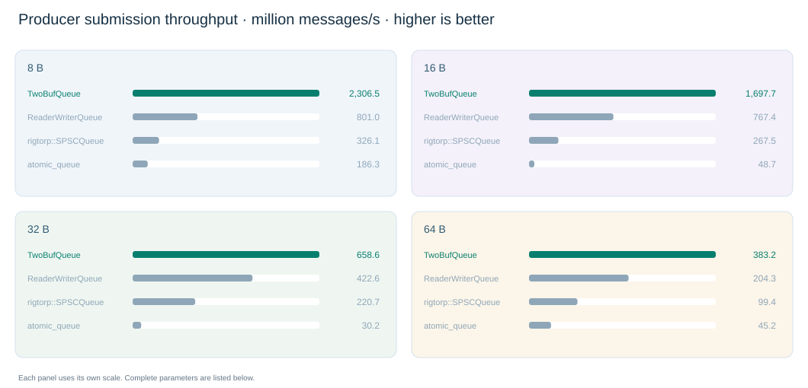

[English](performance_256m_zero_session_plateau.md) · [中文](performance_256m_zero_session_plateau.zh-CN.md)

TWOBUFQUEUE / SPSC BENCHMARK

# 256 MiB capacity · callback iterations 0 · WriteSession

Compare producer message-submission speed and cost: higher throughput and lower producer p50 / p99 / p999 are better. Controls are ReaderWriterQueue, rigtorp/SPSCQueue and atomic_queue.

10,000,000 messages per run Mean of 3 runs One configuration across 8 / 16 / 32 / 64 B Weights 35 / 30 / 20 / 15 publish_count = MAX (4,294,967,295) is_scan_current = false High QoS · no hard affinity

[Measurement](#what-does-this-report-measure) · [Overview](#throughput-overview) · [Performance comparison](#performance-comparison) · [Three individual results](#three-individual-results) · [All parameters](#all-initialization-parameters) · [Methodology](#methodology-and-environment)

## What does this report measure?

Producer submission throughput and cost: how quickly messages enter the queue and how much producer time each message takes.

Compare TwoBufQueue, ReaderWriterQueue, rigtorp/SPSCQueue and atomic_queue with 8 / 16 / 32 / 64 B messages.**TwoBufQueue uses a single-block WriteSession for consecutive writes; the outer loop acquires the next block when the current one fills.** Callback iterations are 0; consumers still receive messages and invoke the callback.

**Procedure:** Prepare messages → time consecutive producer submissions → stop timing → wait for the round to drain. Every queue uses identical message counts and lengths.

**Timing scope:** Timing includes producer payload copying, progress publication, block acquisition/switching during sending and retry waits. Input preparation, end-of-round handoff and callback draining are outside timing. Concurrent copy and consumer threads still affect actual producer speed.

**Throughput:** Successful submissions divided by accumulated producer send time, in M messages/s (million messages per second); higher is better. GB/s uses net payload bytes.

**p50, p99 and p999 are quantiles of producer message-submission cost; lower is better.** To measure short operations accurately, time each group of 1,000 successful submissions and divide its duration by 1,000 to obtain one mean per-message cost sample.

**p50 (50th percentile):** Within a run, 50% of group samples have a mean per-message cost no greater than this value.

**p99 (99th percentile):** Within a run, 99% of group samples have a mean per-message cost no greater than this value.

**p999 (99.9th percentile):** Within a run, 99.9% of group samples have a mean per-message cost no greater than this value.

Compute these quantiles independently per run, then average the three run results. The measurement is **Producer message-submission overhead**: quantiles use 1,000-write group means, not individual write calls or producer-to-consumer end-to-end latency.

Other modes: [Ordinary write · publish MAX](performance_256m_zero_publish_max_plateau.md) · [Ordinary write · publish every record](performance_256m_zero_publish1_plateau.md)

## Throughput overview

Four queues are grouped for each message length; throughput is in M messages/s.

Complete-payload and ordering validation passed Common configuration selected from four metrics One tuned configuration per queue in each report

Each TwoBufQueue data pool is fixed to **256 MiB**, totaling 512 MiB. Native SPSC message storage has a 256 MiB budget, including spare slots and padding; control metadata is counted separately.

**Each queue uses one configuration for throughput, p50, p99 and p999, shared across 8 / 16 / 32 / 64 B.** Selection weights are 35% / 30% / 20% / 15%, with equal participation of all four message lengths. Native capacities derive from a fixed byte budget; copy strategies retain the fixed payload implementation for each length.

The table now uses three search-stage measurements of the common configuration, so it differs from earlier independent per-metric selections. Original records remain; the additional ReaderWriterQueue neighborhood is saved separately.

8 B Throughput · M messages/s

TwoBufQueue 2,306.55

ReaderWriterQueue 801.00

rigtorp/SPSCQueue 326.11

atomic_queue 186.30

16 B Throughput · M messages/s

TwoBufQueue 1,697.73

ReaderWriterQueue 767.38

rigtorp/SPSCQueue 267.48

atomic_queue 48.65

32 B Throughput · M messages/s

TwoBufQueue 658.60

ReaderWriterQueue 422.63

rigtorp/SPSCQueue 220.68

atomic_queue 30.20

64 B Throughput · M messages/s

TwoBufQueue 383.21

ReaderWriterQueue 204.26

rigtorp/SPSCQueue 99.42

atomic_queue 45.19

## Performance comparison

Equal message lengths share a background color; the entire TwoBufQueue row is bold and outlined. Below throughput, the minimum and maximum of three runs are shown.

Message length

**8 B Callback iterations 0 · 10,000,000 messages per run · mean of three runs**

| Implementation / copy strategy | Throughput · M messages/s | Payload throughput · GB/s | Producer submission cost · p50 ns/message | Producer submission cost · p99 ns/message | Producer submission cost · p999 ns/message | Backpressure % |
| --- | --- | --- | --- | --- | --- | --- |
| **TwoBufQueue · Single-block WriteSession** | **[2,306.546](#twobufqueue-initialization-shared-by-all-message-lengths) · 1,955.353 – 2,687.720** | **18.452** | **[0.292](#twobufqueue-initialization-shared-by-all-message-lengths)** | **[1.389](#twobufqueue-initialization-shared-by-all-message-lengths)** | **[1.833](#twobufqueue-initialization-shared-by-all-message-lengths)** | **0% · 0 / 30,000,000** |
| ReaderWriterQueue · Complete member copy | [801.002](#readerwriterqueue-initialization-shared-by-all-message-lengths) · 649.604 – 893.901 | 6.408 | [1.222](#readerwriterqueue-initialization-shared-by-all-message-lengths) | [1.972](#readerwriterqueue-initialization-shared-by-all-message-lengths) | [2.694](#readerwriterqueue-initialization-shared-by-all-message-lengths) | 0% · 0 / 30,000,000 |
| rigtorp/SPSCQueue · Member copy + destination write prefetch | [326.105](#rigtorpspscqueue-initialization-shared-by-all-message-lengths) · 313.386 – 333.183 | 2.609 | [3.000](#rigtorpspscqueue-initialization-shared-by-all-message-lengths) | [4.347](#rigtorpspscqueue-initialization-shared-by-all-message-lengths) | [6.708](#rigtorpspscqueue-initialization-shared-by-all-message-lengths) | 0% · 0 / 30,000,000 |
| atomic_queue · Complete member copy | [186.298](#atomic_queue-initialization-shared-by-all-message-lengths) · 175.399 – 198.343 | 1.490 | [4.986](#atomic_queue-initialization-shared-by-all-message-lengths) | [17.583](#atomic_queue-initialization-shared-by-all-message-lengths) | [36.542](#atomic_queue-initialization-shared-by-all-message-lengths) | 0% · 0 / 30,000,000 |

**16 B Callback iterations 0 · 10,000,000 messages per run · mean of three runs**

| Implementation / copy strategy | Throughput · M messages/s | Payload throughput · GB/s | Producer submission cost · p50 ns/message | Producer submission cost · p99 ns/message | Producer submission cost · p999 ns/message | Backpressure % |
| --- | --- | --- | --- | --- | --- | --- |
| **TwoBufQueue · Single-block WriteSession** | **[1,697.726](#twobufqueue-initialization-shared-by-all-message-lengths) · 1,469.391 – 2,014.335** | **27.164** | **[0.472](#twobufqueue-initialization-shared-by-all-message-lengths)** | **[1.653](#twobufqueue-initialization-shared-by-all-message-lengths)** | **[2.917](#twobufqueue-initialization-shared-by-all-message-lengths)** | **0% · 0 / 30,000,000** |
| ReaderWriterQueue · Zero destination, then copy the full payload with memcpy | [767.375](#readerwriterqueue-initialization-shared-by-all-message-lengths) · 724.706 – 800.675 | 12.278 | [1.319](#readerwriterqueue-initialization-shared-by-all-message-lengths) | [2.569](#readerwriterqueue-initialization-shared-by-all-message-lengths) | [5.653](#readerwriterqueue-initialization-shared-by-all-message-lengths) | 0% · 0 / 30,000,000 |
| rigtorp/SPSCQueue · Member copy + destination write prefetch | [267.481](#rigtorpspscqueue-initialization-shared-by-all-message-lengths) · 230.185 – 304.328 | 4.280 | [3.097](#rigtorpspscqueue-initialization-shared-by-all-message-lengths) | [5.861](#rigtorpspscqueue-initialization-shared-by-all-message-lengths) | [8.861](#rigtorpspscqueue-initialization-shared-by-all-message-lengths) | 0% · 0 / 30,000,000 |
| atomic_queue · Complete member copy | [48.655](#atomic_queue-initialization-shared-by-all-message-lengths) · 43.680 – 52.157 | 0.778 | [13.375](#atomic_queue-initialization-shared-by-all-message-lengths) | [40.083](#atomic_queue-initialization-shared-by-all-message-lengths) | [43.278](#atomic_queue-initialization-shared-by-all-message-lengths) | 0% · 0 / 30,000,000 |

**32 B Callback iterations 0 · 10,000,000 messages per run · mean of three runs**

| Implementation / copy strategy | Throughput · M messages/s | Payload throughput · GB/s | Producer submission cost · p50 ns/message | Producer submission cost · p99 ns/message | Producer submission cost · p999 ns/message | Backpressure % |
| --- | --- | --- | --- | --- | --- | --- |
| **TwoBufQueue · Single-block WriteSession** | **[658.601](#twobufqueue-initialization-shared-by-all-message-lengths) · 391.339 – 835.602** | **21.075** | **[1.028](#twobufqueue-initialization-shared-by-all-message-lengths)** | **[6.222](#twobufqueue-initialization-shared-by-all-message-lengths)** | **[10.306](#twobufqueue-initialization-shared-by-all-message-lengths)** | **0% · 0 / 30,000,000** |
| ReaderWriterQueue · Zero destination, then copy the full payload with memcpy | [422.627](#readerwriterqueue-initialization-shared-by-all-message-lengths) · 390.659 – 440.068 | 13.524 | [2.667](#readerwriterqueue-initialization-shared-by-all-message-lengths) | [4.903](#readerwriterqueue-initialization-shared-by-all-message-lengths) | [9.722](#readerwriterqueue-initialization-shared-by-all-message-lengths) | 0% · 0 / 30,000,000 |
| rigtorp/SPSCQueue · Member copy + destination write prefetch | [220.680](#rigtorpspscqueue-initialization-shared-by-all-message-lengths) · 172.547 – 252.079 | 7.062 | [4.056](#rigtorpspscqueue-initialization-shared-by-all-message-lengths) | [14.097](#rigtorpspscqueue-initialization-shared-by-all-message-lengths) | [17.292](#rigtorpspscqueue-initialization-shared-by-all-message-lengths) | 0% · 0 / 30,000,000 |
| atomic_queue · Complete member copy | [30.202](#atomic_queue-initialization-shared-by-all-message-lengths) · 28.745 – 31.363 | 0.966 | [35.847](#atomic_queue-initialization-shared-by-all-message-lengths) | [69.181](#atomic_queue-initialization-shared-by-all-message-lengths) | [314.000](#atomic_queue-initialization-shared-by-all-message-lengths) | 0% · 0 / 30,000,000 |

**64 B Callback iterations 0 · 10,000,000 messages per run · mean of three runs**

| Implementation / copy strategy | Throughput · M messages/s | Payload throughput · GB/s | Producer submission cost · p50 ns/message | Producer submission cost · p99 ns/message | Producer submission cost · p999 ns/message | Backpressure % |
| --- | --- | --- | --- | --- | --- | --- |
| **TwoBufQueue · Single-block WriteSession** | **[383.213](#twobufqueue-initialization-shared-by-all-message-lengths) · 355.437 – 408.296** | **24.526** | **[2.208](#twobufqueue-initialization-shared-by-all-message-lengths)** | **[7.625](#twobufqueue-initialization-shared-by-all-message-lengths)** | **[11.542](#twobufqueue-initialization-shared-by-all-message-lengths)** | **0% · 0 / 30,000,000** |
| ReaderWriterQueue · Complete member copy | [204.257](#readerwriterqueue-initialization-shared-by-all-message-lengths) · 142.833 – 239.658 | 13.072 | [4.681](#readerwriterqueue-initialization-shared-by-all-message-lengths) | [9.875](#readerwriterqueue-initialization-shared-by-all-message-lengths) | [20.361](#readerwriterqueue-initialization-shared-by-all-message-lengths) | 0% · 0 / 30,000,000 |
| rigtorp/SPSCQueue · Member copy + destination write prefetch | [99.415](#rigtorpspscqueue-initialization-shared-by-all-message-lengths) · 65.287 – 126.390 | 6.363 | [7.361](#rigtorpspscqueue-initialization-shared-by-all-message-lengths) | [22.861](#rigtorpspscqueue-initialization-shared-by-all-message-lengths) | [26.194](#rigtorpspscqueue-initialization-shared-by-all-message-lengths) | 0% · 0 / 30,000,000 |
| atomic_queue · Complete member copy | [45.193](#atomic_queue-initialization-shared-by-all-message-lengths) · 39.567 – 48.690 | 2.892 | [29.764](#atomic_queue-initialization-shared-by-all-message-lengths) | [40.028](#atomic_queue-initialization-shared-by-all-message-lengths) | [56.222](#atomic_queue-initialization-shared-by-all-message-lengths) | 0% · 0 / 30,000,000 |

The table's p50 / p99 / p999 measure **Time spent submitting messages in the producer thread**: first calculate the mean cost of each group of **Mean cost of 1,000 successful writes** quantiles, averaged over three runs; these are neither individual-call nor end-to-end latency. Every metric in a row uses one configuration, shared across all four lengths for that queue. Combined selection makes tradeoffs; individual metrics are no longer claimed to be independently optimal. Click any metric to inspect that same complete configuration.**Backpressure % = messages affected by backpressure ÷ total messages × 100%**, using combined totals from three throughput runs; numerator and denominator are also shown below. A message counts once even if several write attempts fail.

## Three individual results

All three measurements are retained, including slow results. All four metrics use the same configuration ID.

### 8 B Three individual results and their mean

| Implementation / metric | Run 1 | Run 2 | Run 3 | Mean |
| --- | --- | --- | --- | --- |
| **TwoBufQueue · [Throughput M messages/s · config c16e7206959f](#twobufqueue-initialization-shared-by-all-message-lengths)** | **1,955.353** | **2,276.565** | **2,687.720** | **2,306.546** |
| **TwoBufQueue · [p50 ns/message · config c16e7206959f](#twobufqueue-initialization-shared-by-all-message-lengths)** | **0.292** | **0.292** | **0.292** | **0.292** |
| **TwoBufQueue · [p99 ns/message · config c16e7206959f](#twobufqueue-initialization-shared-by-all-message-lengths)** | **1.333** | **1.375** | **1.458** | **1.389** |
| **TwoBufQueue · [p999 ns/message · config c16e7206959f](#twobufqueue-initialization-shared-by-all-message-lengths)** | **1.875** | **1.833** | **1.792** | **1.833** |
| ReaderWriterQueue · [Throughput M messages/s · config 05c6a693ebc0](#readerwriterqueue-initialization-shared-by-all-message-lengths) | 859.500 | 649.604 | 893.901 | 801.002 |
| ReaderWriterQueue · [p50 ns/message · config 05c6a693ebc0](#readerwriterqueue-initialization-shared-by-all-message-lengths) | 1.208 | 1.208 | 1.250 | 1.222 |
| ReaderWriterQueue · [p99 ns/message · config 05c6a693ebc0](#readerwriterqueue-initialization-shared-by-all-message-lengths) | 2.042 | 1.833 | 2.042 | 1.972 |
| ReaderWriterQueue · [p999 ns/message · config 05c6a693ebc0](#readerwriterqueue-initialization-shared-by-all-message-lengths) | 3.417 | 2.125 | 2.542 | 2.694 |
| rigtorp/SPSCQueue · [Throughput M messages/s · config ddbed3127220](#rigtorpspscqueue-initialization-shared-by-all-message-lengths) | 331.746 | 333.183 | 313.386 | 326.105 |
| rigtorp/SPSCQueue · [p50 ns/message · config ddbed3127220](#rigtorpspscqueue-initialization-shared-by-all-message-lengths) | 3.125 | 2.917 | 2.958 | 3.000 |
| rigtorp/SPSCQueue · [p99 ns/message · config ddbed3127220](#rigtorpspscqueue-initialization-shared-by-all-message-lengths) | 4.583 | 4.208 | 4.250 | 4.347 |
| rigtorp/SPSCQueue · [p999 ns/message · config ddbed3127220](#rigtorpspscqueue-initialization-shared-by-all-message-lengths) | 7.042 | 6.583 | 6.500 | 6.708 |
| atomic_queue · [Throughput M messages/s · config f54226336788](#atomic_queue-initialization-shared-by-all-message-lengths) | 198.343 | 175.399 | 185.152 | 186.298 |
| atomic_queue · [p50 ns/message · config f54226336788](#atomic_queue-initialization-shared-by-all-message-lengths) | 4.917 | 5.000 | 5.042 | 4.986 |
| atomic_queue · [p99 ns/message · config f54226336788](#atomic_queue-initialization-shared-by-all-message-lengths) | 7.167 | 8.875 | 36.708 | 17.583 |
| atomic_queue · [p999 ns/message · config f54226336788](#atomic_queue-initialization-shared-by-all-message-lengths) | 37.500 | 34.708 | 37.417 | 36.542 |

### 16 B Three individual results and their mean

| Implementation / metric | Run 1 | Run 2 | Run 3 | Mean |
| --- | --- | --- | --- | --- |
| **TwoBufQueue · [Throughput M messages/s · config d43262717095](#twobufqueue-initialization-shared-by-all-message-lengths)** | **1,469.391** | **1,609.453** | **2,014.335** | **1,697.726** |
| **TwoBufQueue · [p50 ns/message · config d43262717095](#twobufqueue-initialization-shared-by-all-message-lengths)** | **0.458** | **0.500** | **0.458** | **0.472** |
| **TwoBufQueue · [p99 ns/message · config d43262717095](#twobufqueue-initialization-shared-by-all-message-lengths)** | **1.667** | **1.750** | **1.542** | **1.653** |
| **TwoBufQueue · [p999 ns/message · config d43262717095](#twobufqueue-initialization-shared-by-all-message-lengths)** | **2.542** | **3.833** | **2.375** | **2.917** |
| ReaderWriterQueue · [Throughput M messages/s · config 1fe946d9a7bc](#readerwriterqueue-initialization-shared-by-all-message-lengths) | 724.706 | 800.675 | 776.744 | 767.375 |
| ReaderWriterQueue · [p50 ns/message · config 1fe946d9a7bc](#readerwriterqueue-initialization-shared-by-all-message-lengths) | 1.208 | 1.500 | 1.250 | 1.319 |
| ReaderWriterQueue · [p99 ns/message · config 1fe946d9a7bc](#readerwriterqueue-initialization-shared-by-all-message-lengths) | 2.375 | 2.958 | 2.375 | 2.569 |
| ReaderWriterQueue · [p999 ns/message · config 1fe946d9a7bc](#readerwriterqueue-initialization-shared-by-all-message-lengths) | 3.375 | 9.542 | 4.042 | 5.653 |
| rigtorp/SPSCQueue · [Throughput M messages/s · config 488489a115af](#rigtorpspscqueue-initialization-shared-by-all-message-lengths) | 304.328 | 230.185 | 267.931 | 267.481 |
| rigtorp/SPSCQueue · [p50 ns/message · config 488489a115af](#rigtorpspscqueue-initialization-shared-by-all-message-lengths) | 3.042 | 3.208 | 3.042 | 3.097 |
| rigtorp/SPSCQueue · [p99 ns/message · config 488489a115af](#rigtorpspscqueue-initialization-shared-by-all-message-lengths) | 5.750 | 6.375 | 5.458 | 5.861 |
| rigtorp/SPSCQueue · [p999 ns/message · config 488489a115af](#rigtorpspscqueue-initialization-shared-by-all-message-lengths) | 9.417 | 9.583 | 7.583 | 8.861 |
| atomic_queue · [Throughput M messages/s · config 7afaa762ae1a](#atomic_queue-initialization-shared-by-all-message-lengths) | 50.128 | 52.157 | 43.680 | 48.655 |
| atomic_queue · [p50 ns/message · config 7afaa762ae1a](#atomic_queue-initialization-shared-by-all-message-lengths) | 6.625 | 12.625 | 20.875 | 13.375 |
| atomic_queue · [p99 ns/message · config 7afaa762ae1a](#atomic_queue-initialization-shared-by-all-message-lengths) | 38.375 | 40.875 | 41.000 | 40.083 |
| atomic_queue · [p999 ns/message · config 7afaa762ae1a](#atomic_queue-initialization-shared-by-all-message-lengths) | 42.292 | 43.667 | 43.875 | 43.278 |

### 32 B Three individual results and their mean

| Implementation / metric | Run 1 | Run 2 | Run 3 | Mean |
| --- | --- | --- | --- | --- |
| **TwoBufQueue · [Throughput M messages/s · config 1b2d5f417aa7](#twobufqueue-initialization-shared-by-all-message-lengths)** | **391.339** | **835.602** | **748.860** | **658.601** |
| **TwoBufQueue · [p50 ns/message · config 1b2d5f417aa7](#twobufqueue-initialization-shared-by-all-message-lengths)** | **1.000** | **1.042** | **1.042** | **1.028** |
| **TwoBufQueue · [p99 ns/message · config 1b2d5f417aa7](#twobufqueue-initialization-shared-by-all-message-lengths)** | **3.958** | **7.500** | **7.208** | **6.222** |
| **TwoBufQueue · [p999 ns/message · config 1b2d5f417aa7](#twobufqueue-initialization-shared-by-all-message-lengths)** | **8.458** | **10.792** | **11.667** | **10.306** |
| ReaderWriterQueue · [Throughput M messages/s · config 37b8e391eac3](#readerwriterqueue-initialization-shared-by-all-message-lengths) | 437.154 | 440.068 | 390.659 | 422.627 |
| ReaderWriterQueue · [p50 ns/message · config 37b8e391eac3](#readerwriterqueue-initialization-shared-by-all-message-lengths) | 3.042 | 2.958 | 2.000 | 2.667 |
| ReaderWriterQueue · [p99 ns/message · config 37b8e391eac3](#readerwriterqueue-initialization-shared-by-all-message-lengths) | 6.167 | 4.208 | 4.333 | 4.903 |
| ReaderWriterQueue · [p999 ns/message · config 37b8e391eac3](#readerwriterqueue-initialization-shared-by-all-message-lengths) | 10.750 | 9.500 | 8.917 | 9.722 |
| rigtorp/SPSCQueue · [Throughput M messages/s · config 626a79b8b850](#rigtorpspscqueue-initialization-shared-by-all-message-lengths) | 237.414 | 172.547 | 252.079 | 220.680 |
| rigtorp/SPSCQueue · [p50 ns/message · config 626a79b8b850](#rigtorpspscqueue-initialization-shared-by-all-message-lengths) | 4.042 | 4.042 | 4.083 | 4.056 |
| rigtorp/SPSCQueue · [p99 ns/message · config 626a79b8b850](#rigtorpspscqueue-initialization-shared-by-all-message-lengths) | 13.917 | 15.000 | 13.375 | 14.097 |
| rigtorp/SPSCQueue · [p999 ns/message · config 626a79b8b850](#rigtorpspscqueue-initialization-shared-by-all-message-lengths) | 15.833 | 18.875 | 17.167 | 17.292 |
| atomic_queue · [Throughput M messages/s · config b998250847cc](#atomic_queue-initialization-shared-by-all-message-lengths) | 31.363 | 28.745 | 30.499 | 30.202 |
| atomic_queue · [p50 ns/message · config b998250847cc](#atomic_queue-initialization-shared-by-all-message-lengths) | 35.042 | 37.000 | 35.500 | 35.847 |
| atomic_queue · [p99 ns/message · config b998250847cc](#atomic_queue-initialization-shared-by-all-message-lengths) | 110.958 | 41.833 | 54.750 | 69.181 |
| atomic_queue · [p999 ns/message · config b998250847cc](#atomic_queue-initialization-shared-by-all-message-lengths) | 818.792 | 54.000 | 69.208 | 314.000 |

### 64 B Three individual results and their mean

| Implementation / metric | Run 1 | Run 2 | Run 3 | Mean |
| --- | --- | --- | --- | --- |
| **TwoBufQueue · [Throughput M messages/s · config 2c0b1cb7032e](#twobufqueue-initialization-shared-by-all-message-lengths)** | **408.296** | **355.437** | **385.908** | **383.213** |
| **TwoBufQueue · [p50 ns/message · config 2c0b1cb7032e](#twobufqueue-initialization-shared-by-all-message-lengths)** | **1.958** | **2.292** | **2.375** | **2.208** |
| **TwoBufQueue · [p99 ns/message · config 2c0b1cb7032e](#twobufqueue-initialization-shared-by-all-message-lengths)** | **7.500** | **7.708** | **7.667** | **7.625** |
| **TwoBufQueue · [p999 ns/message · config 2c0b1cb7032e](#twobufqueue-initialization-shared-by-all-message-lengths)** | **8.792** | **12.583** | **13.250** | **11.542** |
| ReaderWriterQueue · [Throughput M messages/s · config 8f16777e2f59](#readerwriterqueue-initialization-shared-by-all-message-lengths) | 142.833 | 230.279 | 239.658 | 204.257 |
| ReaderWriterQueue · [p50 ns/message · config 8f16777e2f59](#readerwriterqueue-initialization-shared-by-all-message-lengths) | 4.875 | 5.083 | 4.083 | 4.681 |
| ReaderWriterQueue · [p99 ns/message · config 8f16777e2f59](#readerwriterqueue-initialization-shared-by-all-message-lengths) | 11.125 | 10.792 | 7.708 | 9.875 |
| ReaderWriterQueue · [p999 ns/message · config 8f16777e2f59](#readerwriterqueue-initialization-shared-by-all-message-lengths) | 30.708 | 15.333 | 15.042 | 20.361 |
| rigtorp/SPSCQueue · [Throughput M messages/s · config 0d1082002fb0](#rigtorpspscqueue-initialization-shared-by-all-message-lengths) | 65.287 | 106.570 | 126.390 | 99.415 |
| rigtorp/SPSCQueue · [p50 ns/message · config 0d1082002fb0](#rigtorpspscqueue-initialization-shared-by-all-message-lengths) | 7.750 | 6.875 | 7.458 | 7.361 |
| rigtorp/SPSCQueue · [p99 ns/message · config 0d1082002fb0](#rigtorpspscqueue-initialization-shared-by-all-message-lengths) | 22.958 | 22.250 | 23.375 | 22.861 |
| rigtorp/SPSCQueue · [p999 ns/message · config 0d1082002fb0](#rigtorpspscqueue-initialization-shared-by-all-message-lengths) | 26.542 | 25.125 | 26.917 | 26.194 |
| atomic_queue · [Throughput M messages/s · config b4753ca6ef75](#atomic_queue-initialization-shared-by-all-message-lengths) | 39.567 | 48.690 | 47.322 | 45.193 |
| atomic_queue · [p50 ns/message · config b4753ca6ef75](#atomic_queue-initialization-shared-by-all-message-lengths) | 34.292 | 25.375 | 29.625 | 29.764 |
| atomic_queue · [p99 ns/message · config b4753ca6ef75](#atomic_queue-initialization-shared-by-all-message-lengths) | 41.417 | 38.792 | 39.875 | 40.028 |
| atomic_queue · [p999 ns/message · config b4753ca6ef75](#atomic_queue-initialization-shared-by-all-message-lengths) | 78.833 | 44.708 | 45.125 | 56.222 |

Throughput and latency each have three runs; modes and random seeds are recorded as run. Each p999 uses approximately 10,000 group samples, leaving about 10 tail samples and sensitivity to scheduling variation.

## All initialization parameters

Initialization is listed once per queue and shared by all message lengths. Per-length values such as slot counts use derivation rules; complete run settings are retained in exported JSON and raw records.

### TwoBufQueue: initialization shared by all message lengths

All 61 test-class parameters and constructor/template arguments are listed. Message lengths use one shared value list; derived capacities and fixed per-length copy choices use by_payload_bytes mappings instead of four repeated parameter sets.

### Test-class parameters

| Parameter | Value |
| --- | --- |
| transport | two_buf_queue |
| mode | ["throughput", "write_latency"] |
| payload_bytes | [8, 16, 32, 64] |
| messages | 10000000 |
| warmup_messages | 50000 |
| callback_iterations | 0 |
| verify_payload | false |
| prepared_input | true |
| variable_payload | true |
| prepared_input_limit_bytes | 268435456 |
| measure_callback_time | true |
| producer_interval_ns | 0 |
| source_block_size | 33554432 |
| source_pool_min | 8 |
| source_pool_max | 8 |
| source_queue_capacity | 512 |
| writer_backpressure | drop |
| writer_spin_count | 1000 |
| writer_wait_timeout_ms | 5000 |
| output_block_size | 268435456 |
| output_frame_capacity | 1024 |
| output_pool_min | 1 |
| output_pool_max | 1 |
| output_queue_capacity | 512 |
| cancel_claim_mode | tail |
| output_mode | spsc |
| output_reader_mode | wait_signal |
| output_reader_count | 1 |
| output_retry_wait_us | 1000 |
| output_enable_stats | false |
| is_scan_current | false |
| reader_spin_count | 1000 |
| rescan_interval_ns | 1000000 |
| rescan_max_interval_ns | 1000000 |
| consumer_cpu | -1 |
| producer_cpu | -1 |
| producer_qos | user_interactive |
| round_storage_bytes | 214748364 |
| fixed_round_boundaries | true |
| spsc_buffer_bytes | 0 |
| prefault_producer_buffers | true |
| finish_timeout_ms | 5000 |
| work_wait_min_ms | 1 |
| finish_retry_ms | 1 |
| publish_count | 4294967295 |
| use_write_session | true |
| rigtorp_write_prefetch | true |
| readerwriterqueue_copy_after_zero | false |
| spsc_capacity | 0 |
| retry_yield_every | 1024 |
| spsc_idle_spins | 1000 |
| spsc_idle_sleep_ns | 0 |
| timer | auto |
| sample_every | 32 |
| max_samples | 1000000 |
| latency_batch_size | 1000 |
| timer_calibration_samples | 16384 |
| call_batch_size | 256 |
| random_seed | [42, 43, 44] |
| timeout_seconds | 180 |
| buffer_budget_bytes | 536870912 |

### Constructor and template arguments

| Parameter | Value |
| --- | --- |
| source_thread_id | 0 |
| read_layer1_thread_count | 1 |
| writer_queue_enable_stats | false |
| message_prefix_bytes | 0 |
| writer_count | 1 |
| source_copy_thread_count | 1 |
| callback_thread_count | 1 |
| pool_depth_instrumentation | false |
| callback_signature | (thread_id, data, payload_bytes) |
| callback_business_iterations | 0 |
| writer_type | OwnedWriter<Writer<4294967295, false, uint16_t, void>> |
| writer_api | bounded single-block WriteSession |
| ordinary_write_readback | false |
| sync_context | void |
| callback_wrapper | FixedRecordCallback<PayloadBytes, Sink> |
| source_pool_payload_bytes | 268435456 |
| reader_pool_payload_bytes | 268435456 |

### ReaderWriterQueue: initialization shared by all message lengths

All 61 test-class parameters and constructor/template arguments are listed. Message lengths use one shared value list; derived capacities and fixed per-length copy choices use by_payload_bytes mappings instead of four repeated parameter sets.

### Test-class parameters

| Parameter | Value |
| --- | --- |
| transport | readerwriterqueue |
| mode | ["throughput", "write_latency"] |
| payload_bytes | [8, 16, 32, 64] |
| messages | 10000000 |
| warmup_messages | 50000 |
| callback_iterations | 0 |
| verify_payload | false |
| prepared_input | true |
| variable_payload | true |
| prepared_input_limit_bytes | 268435456 |
| measure_callback_time | true |
| producer_interval_ns | 0 |
| source_block_size | 65536 |
| source_pool_min | 4096 |
| source_pool_max | 4096 |
| source_queue_capacity | 4096 |
| writer_backpressure | drop |
| writer_spin_count | 1000 |
| writer_wait_timeout_ms | 5000 |
| output_block_size | 1048576 |
| output_frame_capacity | 1024 |
| output_pool_min | 256 |
| output_pool_max | 256 |
| output_queue_capacity | 512 |
| cancel_claim_mode | tail |
| output_mode | spsc |
| output_reader_mode | wait_signal |
| output_reader_count | 1 |
| output_retry_wait_us | 1000 |
| output_enable_stats | false |
| is_scan_current | false |
| reader_spin_count | 1000 |
| rescan_interval_ns | 1000000 |
| rescan_max_interval_ns | 1000000 |
| consumer_cpu | -1 |
| producer_cpu | -1 |
| producer_qos | user_interactive |
| round_storage_bytes | 214748364 |
| fixed_round_boundaries | true |
| spsc_buffer_bytes | 268435456 |
| prefault_producer_buffers | true |
| finish_timeout_ms | 5000 |
| work_wait_min_ms | 1 |
| finish_retry_ms | 1 |
| publish_count | 4294967295 |
| use_write_session | false |
| rigtorp_write_prefetch | false |
| readerwriterqueue_copy_after_zero | {"by_payload_bytes": {"8": false, "16": true, "32": true, "64": false}} |
| spsc_capacity | {"by_payload_bytes": {"8": 33488385, "16": 16743937, "32": 8371713, "64": 4185601}} |
| retry_yield_every | 1024 |
| spsc_idle_spins | 0 |
| spsc_idle_sleep_ns | 12500 |
| timer | auto |
| sample_every | 32 |
| max_samples | 1000000 |
| latency_batch_size | 1000 |
| timer_calibration_samples | 16384 |
| call_batch_size | 256 |
| random_seed | [42, 43, 44] |
| timeout_seconds | 180 |
| buffer_budget_bytes | 536870912 |

### Constructor and template arguments

| Parameter | Value |
| --- | --- |
| source_thread_id | 0 |
| read_layer1_thread_count | 1 |
| writer_queue_enable_stats | false |
| message_prefix_bytes | 0 |
| writer_count | 1 |
| source_copy_thread_count | 0 |
| callback_thread_count | 1 |
| pool_depth_instrumentation | false |
| callback_signature | (thread_id, data, payload_bytes) |
| callback_business_iterations | 0 |
| unused_fields | source_* / output_* / reader_spin_count / rescan_* / is_scan_current / publish_count: native SPSC does not construct TwoBufQueue layers |
| upstream_unmodified | true |
| requested_native_capacity | {"by_payload_bytes": {"8": 33488385, "16": 16743937, "32": 8371713, "64": 4185601}} |
| native_template | ReaderWriterQueue<Payload,512> |
| copy_policy | {"by_payload_bytes": {"8": "full member copy", "16": "zero initialization then full memcpy", "32": "zero initialization then full memcpy", "64": "full member copy"}} |
| consumer_operation | peek → callback → pop |

### rigtorp/SPSCQueue: initialization shared by all message lengths

All 61 test-class parameters and constructor/template arguments are listed. Message lengths use one shared value list; derived capacities and fixed per-length copy choices use by_payload_bytes mappings instead of four repeated parameter sets.

### Test-class parameters

| Parameter | Value |
| --- | --- |
| transport | rigtorp |
| mode | ["throughput", "write_latency"] |
| payload_bytes | [8, 16, 32, 64] |
| messages | 10000000 |
| warmup_messages | 50000 |
| callback_iterations | 0 |
| verify_payload | false |
| prepared_input | true |
| variable_payload | true |
| prepared_input_limit_bytes | 268435456 |
| measure_callback_time | true |
| producer_interval_ns | 0 |
| source_block_size | 65536 |
| source_pool_min | 4096 |
| source_pool_max | 4096 |
| source_queue_capacity | 4096 |
| writer_backpressure | drop |
| writer_spin_count | 1000 |
| writer_wait_timeout_ms | 5000 |
| output_block_size | 1048576 |
| output_frame_capacity | 1024 |
| output_pool_min | 256 |
| output_pool_max | 256 |
| output_queue_capacity | 512 |
| cancel_claim_mode | tail |
| output_mode | spsc |
| output_reader_mode | wait_signal |
| output_reader_count | 1 |
| output_retry_wait_us | 1000 |
| output_enable_stats | false |
| is_scan_current | false |
| reader_spin_count | 1000 |
| rescan_interval_ns | 1000000 |
| rescan_max_interval_ns | 1000000 |
| consumer_cpu | -1 |
| producer_cpu | -1 |
| producer_qos | user_interactive |
| round_storage_bytes | 214748364 |
| fixed_round_boundaries | true |
| spsc_buffer_bytes | 268435456 |
| prefault_producer_buffers | true |
| finish_timeout_ms | 5000 |
| work_wait_min_ms | 1 |
| finish_retry_ms | 1 |
| publish_count | 4294967295 |
| use_write_session | false |
| rigtorp_write_prefetch | true |
| readerwriterqueue_copy_after_zero | false |
| spsc_capacity | {"by_payload_bytes": {"8": 33554415, "16": 16777207, "32": 8388603, "64": 4194301}} |
| retry_yield_every | 1024 |
| spsc_idle_spins | 4000 |
| spsc_idle_sleep_ns | 1000 |
| timer | auto |
| sample_every | 32 |
| max_samples | 1000000 |
| latency_batch_size | 1000 |
| timer_calibration_samples | 16384 |
| call_batch_size | 256 |
| random_seed | [42, 43, 44] |
| timeout_seconds | 180 |
| buffer_budget_bytes | 536870912 |

### Constructor and template arguments

| Parameter | Value |
| --- | --- |
| source_thread_id | 0 |
| read_layer1_thread_count | 1 |
| writer_queue_enable_stats | false |
| message_prefix_bytes | 0 |
| writer_count | 1 |
| source_copy_thread_count | 0 |
| callback_thread_count | 1 |
| pool_depth_instrumentation | false |
| callback_signature | (thread_id, data, payload_bytes) |
| callback_business_iterations | 0 |
| unused_fields | source_* / output_* / reader_spin_count / rescan_* / is_scan_current / publish_count: native SPSC does not construct TwoBufQueue layers |
| upstream_unmodified | true |
| requested_native_capacity | {"by_payload_bytes": {"8": 33554415, "16": 16777207, "32": 8388603, "64": 4194301}} |
| native_template | rigtorp::SPSCQueue<Payload> |
| copy_policy | member initialization copy + destination write prefetch |
| consumer_operation | front → callback → pop |

### atomic_queue: initialization shared by all message lengths

All 61 test-class parameters and constructor/template arguments are listed. Message lengths use one shared value list; derived capacities and fixed per-length copy choices use by_payload_bytes mappings instead of four repeated parameter sets.

### Test-class parameters

| Parameter | Value |
| --- | --- |
| transport | atomic_queue |
| mode | ["throughput", "write_latency"] |
| payload_bytes | [8, 16, 32, 64] |
| messages | 10000000 |
| warmup_messages | 50000 |
| callback_iterations | 0 |
| verify_payload | false |
| prepared_input | true |
| variable_payload | true |
| prepared_input_limit_bytes | 268435456 |
| measure_callback_time | true |
| producer_interval_ns | 0 |
| source_block_size | 65536 |
| source_pool_min | 4096 |
| source_pool_max | 4096 |
| source_queue_capacity | 4096 |
| writer_backpressure | drop |
| writer_spin_count | 1000 |
| writer_wait_timeout_ms | 5000 |
| output_block_size | 1048576 |
| output_frame_capacity | 1024 |
| output_pool_min | 256 |
| output_pool_max | 256 |
| output_queue_capacity | 512 |
| cancel_claim_mode | tail |
| output_mode | spsc |
| output_reader_mode | wait_signal |
| output_reader_count | 1 |
| output_retry_wait_us | 1000 |
| output_enable_stats | false |
| is_scan_current | false |
| reader_spin_count | 1000 |
| rescan_interval_ns | 1000000 |
| rescan_max_interval_ns | 1000000 |
| consumer_cpu | -1 |
| producer_cpu | -1 |
| producer_qos | user_interactive |
| round_storage_bytes | 214748364 |
| fixed_round_boundaries | true |
| spsc_buffer_bytes | 268435456 |
| prefault_producer_buffers | true |
| finish_timeout_ms | 5000 |
| work_wait_min_ms | 1 |
| finish_retry_ms | 1 |
| publish_count | 4294967295 |
| use_write_session | false |
| rigtorp_write_prefetch | false |
| readerwriterqueue_copy_after_zero | false |
| spsc_capacity | {"by_payload_bytes": {"8": 33554432, "16": 16777216, "32": 8388608, "64": 4194304}} |
| retry_yield_every | 1024 |
| spsc_idle_spins | 2000 |
| spsc_idle_sleep_ns | 10000 |
| timer | auto |
| sample_every | 32 |
| max_samples | 1000000 |
| latency_batch_size | 1000 |
| timer_calibration_samples | 16384 |
| call_batch_size | 256 |
| random_seed | [42, 43, 44] |
| timeout_seconds | 180 |
| buffer_budget_bytes | 536870912 |

### Constructor and template arguments

| Parameter | Value |
| --- | --- |
| source_thread_id | 0 |
| read_layer1_thread_count | 1 |
| writer_queue_enable_stats | false |
| message_prefix_bytes | 0 |
| writer_count | 1 |
| source_copy_thread_count | 0 |
| callback_thread_count | 1 |
| pool_depth_instrumentation | false |
| callback_signature | (thread_id, data, payload_bytes) |
| callback_business_iterations | 0 |
| unused_fields | source_* / output_* / reader_spin_count / rescan_* / is_scan_current / publish_count: native SPSC does not construct TwoBufQueue layers |
| upstream_unmodified | true |
| requested_native_capacity | {"by_payload_bytes": {"8": 33554432, "16": 16777216, "32": 8388608, "64": 4194304}} |
| native_template | AtomicQueueB2<Payload,std::allocator<Payload>,true,false,true> |
| copy_policy | full member copy |
| consumer_operation | try_pop → callback |

## Methodology and environment

Retain the existing results, payload, copy strategy and selection rules.

### Fixed test procedure

10 million messages per run, 50,000 warmup messages, callback iterations 0. Input is prepared before write timing, and every payload word varies.

Fixed round limit: **214,748,364 B**, equal to 80% of the 256 MiB layer-2 budget. All queues use identical round boundaries; the final round ends at the actual message count.

Only accumulated producer write time is timed. End-of-round handoff, tail publication and callback draining occur outside timing; every message must still be consumed. TwoBufQueue copy and callback threads run independently.

Ordinary write reads back the first byte after the complete copy; Session does not add this readback.

### Plateau rules for combined selection

Use common configurations measured at all four lengths. Writer candidates are three neighboring block sizes growing by powers of two; native SPSC candidates are three neighboring spin or wait settings.

The four-length composite scores of three neighboring configurations differ by at most 10%; the coefficient of variation of composite scores grouped by run number is at most 20%. Individual results, variation and neighborhood changes for every length are retained.

Every configuration passes complete validation. Three throughput and three latency runs succeed, with zero write failures, zero Writer backpressure and resolvable latency. Reference coefficients of variation remain capped at 20% / 25% / 40% / 60%.

All metrics use one configuration. Search-stage results are not mixed with earlier independent rechecks. This is the best combined plateau within the measured common configurations, not proof of a global optimum.

### Host and build

macOS-14.4.1-arm64-arm-64bit · arm64 · 8 logical CPUs.

Clang 18.1.8 · Release · -O3 -DNDEBUG · no sanitizer.

Producer user_interactive QoS, without hard affinity; copy and callback threads are unpinned. Timer: mach_absolute_time; 1,000 writes per timing group.

Additional measurements use the original executable with identical SHA-256. Upstream headers, complete payloads and copy strategies are unchanged. AC power was confirmed beforehand.

### Data and auditability

The original batch contains 1,284 complete validations and 9,708 measurements, with 0 failed runs. The additional ReaderWriterQueue neighborhood contains 24 complete validations and 144 measurements, with 0 failures.

The three reports share the same native SPSC controls. Copy strategies are fixed as disclosed in the table; they and compiler-generated code also affect results.

Earlier per-metric selections are backed up. All four metrics here use common configurations; reference values were fixed before additional measurements. Detailed run settings record actual mode and random_seed values.

Measured executable SHA-256: 1a898890a865e21c4842f8f40f56c3cf9bbfdde912ff2de86782a5c9a3eb0493

[Configuration selection record](../../performance_data/plateau_compare_256m_zero_20261012/weighted_common_config_20261012/weighted_common_selection.json.gz) · [Selection program](../../performance_data/plateau_compare_256m_zero_20261012/weighted_common_config_20261012/select_weighted.py) · [Additional ReaderWriterQueue measurements](../../performance_data/plateau_compare_256m_zero_20261012/weighted_common_config_20261012/readerwriterqueue_combined/raw.jsonl) · [Original search records](../../performance_data/plateau_compare_256m_zero_20261012/raw.jsonl.gz) · [Original candidate list](../../performance_data/plateau_compare_256m_zero_20261012/all_candidates.csv.gz) · [Measurement audit](../../performance_data/plateau_compare_256m_zero_20261012/audit.json) · [Environment and dependencies](../../performance_data/plateau_compare_256m_zero_20261012/environment.json) · [Measured source](../../performance_data/plateau_compare_256m_zero_20261012/measurement_sources.tar.gz) · [Report generator](../../performance_data/plateau_compare_256m_zero_20261012/restyle_comparison.py)

Updated: 2026-10-12 · common configuration selected by stated weights · 256 MiB / callback iterations 0 / mean of three runs
